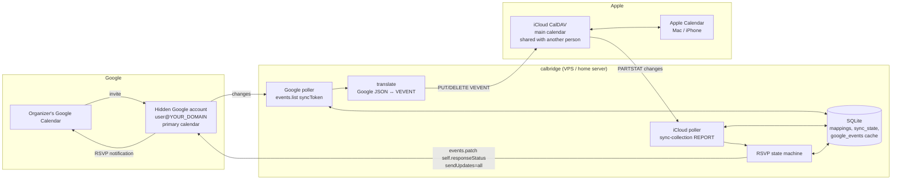

# calbridge — Google Calendar invitations → iCloud Calendar with RSVP back-propagation

Implementation plan for Claude Code. Status: **plan only, no code yet.**
Working name: `calbridge` (Go module `github.com/JasonBerry/calbridge`, binary `calbridge`).

Conventions used in this document:

- **VERIFIED** = checked against a source listed in [§19 Sources](#19-sources) during planning (Nov 2026).
- **UNVERIFIED** = plausible but not confirmed; must not be relied on without the Phase 0 experiment or a test that proves it.
- **DECISION** = a choice made in this plan; changing it needs the user's agreement (see CLAUDE.md rules).
- Placeholders: `YOUR_DOMAIN`, `user@YOUR_DOMAIN` (the custom-domain address, which is also the hidden Google account's login), `APPLE_ID_EMAIL`, `GOOGLE_CLIENT_ID`, `ORGANIZER_TEST` (a second, throwaway Google account used only to send test invites). The real values for this project are in the table below; use them in local config and manual steps, but keep committed code, fixtures and docs on placeholders.

### Project values

| Placeholder | Value for this project | Notes |
|---|---|---|
| `YOUR_GITHUB_USER` | `JasonBerry` | Repo: `github.com/JasonBerry/calbridge`. **Create it as a private repository** (this plan names real addresses). |
| `YOUR_DOMAIN` | *(set in the local, git-ignored config)* | Custom domain on iCloud+. |
| `user@YOUR_DOMAIN` | *(set in the local, git-ignored config)* | One address serving three roles: the iCloud/Apple Account, the iCloud Mail address, and the login of the hidden Google account (Google account created with "use my current email address"). So `self_email` and `attendee_email` in config are both this address. |
| `APPLE_ID_EMAIL` | *(set in the local, git-ignored config)* | Same as above, so P0-4 variant D (ATTENDEE as the Apple Account address) is identical to variants A–C and can be skipped. If P0-3 shows Apple also exposes a different primary address (e.g. an `@icloud.com` alias) in `calendar-user-address-set`, test that address as variant D instead. |
| `ORGANIZER_TEST` | *(set in the local, git-ignored config)* | Existing personal test Google account, used only to send test invites to `user@YOUR_DOMAIN` and to observe what the organizer sees (RSVP status, stray emails). It is not the hidden account and never syncs to anything. |
| Timezone | `Australia/Sydney` | Used in all Phase 0 test events. |
| iCloud target calendar | **not yet decided** | See §17. Phase 0 and all spikes use a throwaway `calbridge-test` calendar; the main shared calendar is untouched until the user says so. |


---

## Table of contents

1. Goals, non-goals, architecture
2. Phase 0: spike / de-risking (manual setup + experiments + decision rules)
3. Technology choices (verified versions)
4. iCloud CalDAV facts
5. Google Calendar API facts
6. Data model (SQLite DDL)
7. Event translation rules (Google JSON ↔ iCalendar)
8. Sync algorithms (pseudocode)
9. Scheduling and runtime
10. Configuration and secrets
11. Package layout and interfaces
12. Testing strategy
13. Deployment and monitoring
14. Security and privacy
15. Milestones for Claude Code
16. CLAUDE.md (ready to paste)
17. Open questions (with defaults)
18. Risks and design concerns
19. Sources

---

## 1. Goals, non-goals, architecture

### Goals

| # | Goal |
|---|------|
| G1 | Every Google Calendar invitation sent to `user@YOUR_DOMAIN` appears automatically, as a normal event, in the user's **existing** iCloud calendar (config-selected; default: their main calendar, which is shared with another person). |
| G2 | Organizer updates (time, title, location, description, cancellation, recurrence changes) update/remove the same mirrored event. No duplicates. |
| G3 | The user can Accept / Maybe / Decline on the mirrored event in Apple Calendar (macOS/iOS), and the organizer receives that response through Google. |
| G4 | No ping-pong: each change is propagated at most once; re-running a sync with no upstream change performs zero writes. |
| G5 | Runs unattended on a small server; tells the user when credentials break. |

### Non-goals (v1)

- Invitations from non-Google organizers (Outlook, Apple, Fastmail…). These never reach the hidden Google calendar, so they are out of scope.
- Mirroring the user's own iCloud events into Google (no iCloud → Google content sync).
- Editing event content from Apple (title/time changes made in Apple to a mirror are overwritten by the next Google change; see §8 conflict policy).
- Proposing new times, delegating, forwarding.
- Multi-user / multi-tenant operation. One Google account, one Apple account, one target calendar.
- Push notifications in v1 (polling only; `events.watch` is an optional later milestone).

### Architecture



ASCII fallback:

```
Organizer (Google) --invite--> Hidden Google acct (user@YOUR_DOMAIN)
                                   |  events.list?syncToken            ^ events.patch (self responseStatus, sendUpdates=all)
                                   v                                   |
                         +------------------ calbridge ------------------+
                         | Google poller -> translate -> CalDAV writer  |
                         | iCloud poller -> RSVP state machine ---------+
                         |            SQLite (mappings, tokens, cache)  |
                         +----------------------------------------------+
                                   | PUT/DELETE (If-Match)             ^ sync-collection REPORT
                                   v                                   |
                         iCloud CalDAV: existing main calendar (shared with another person) <-> Apple Calendar
```

### Recommended runtime shape (DECISION)

A **single long-running binary** (`calbridge serve`) with an internal ticker, plus `calbridge once` for cron/debugging. Reasons: one process owns the lock and the SQLite file; a long-running process can later host the `events.watch` webhook and the optional RSVP fallback page (§2.5) without restructuring; backoff state lives in memory. `once` exists so the same code can run from a systemd timer if the user prefers.

---

## 2. Phase 0: spike / de-risking

Phase 0 must be completed and its results recorded in `docs/phase0-results.md` **before** milestones M4+ (see §15). Phase 0 code is throwaway-quality but lives in the repo as `calbridge spike …` subcommands (built in M1–M3) so experiments are repeatable.

### 2.1 Manual setup the user must do (one-time)

Do these in order. Nothing here should be automated.

**Google side**

1. Create the Google account with "Use my current email address instead" = `user@YOUR_DOMAIN` (already done or planned). Do **not** add it to Apple devices.
2. In that account's Google Calendar web UI → Settings → General → *Event settings* → **"Add invitations to my calendar" = "From everyone"** (VERIFIED option exists, and "From everyone" means "All invitations are automatically added to your calendar"). Without this, invitations from unknown senders arrive only by email and never appear in the API.
3. Also in Google Calendar settings: set the calendar's time zone to the user's home zone (`Australia/Sydney`), and consider turning off Google's own email notifications for this account (they would go to the same iCloud mailbox). UNVERIFIED which notification toggles exist for invitation emails; this is cosmetic.
4. Google Cloud Console (logged in as any account the user controls; can be the hidden one):
   1. Create project `calbridge`.
   2. APIs & Services → Library → enable **Google Calendar API**.
   3. OAuth consent screen (Google Auth Platform): User type **External**; app name `calbridge`; support email; add scope `https://www.googleapis.com/auth/calendar.events`; add `user@YOUR_DOMAIN` as a test user (harmless).
   4. **Publish the app ("In production")**. Do not leave it in Testing: Google documents "the 7-day refresh token expiration limit for apps in the Testing status" (VERIFIED). The app will be *unverified*; Google calls publishing unverified apps "strongly discouraged" and applies a hard cap of 100 users plus an "unverified app" warning screen (VERIFIED). For a single personal user this is acceptable: on consent, click *Advanced → Go to calbridge (unsafe)*.
   5. Credentials → Create OAuth client ID → Application type **Desktop app**. Download the JSON as `google-client.json`. (Desktop clients still support the loopback redirect flow — VERIFIED.)
5. Use the personal Gmail `ORGANIZER_TEST@example.com` (not the hidden account) as the organizer for sending test invites.

**Apple side**

6. appleid.apple.com → Sign-In and Security → **App-Specific Passwords** → generate one named `calbridge` (requires 2FA; up to 25 active; changing the Apple Account password revokes all of them — VERIFIED via third-party guide, see §4).
7. In Apple Calendar on the Mac, create a **scratch calendar** `calbridge-test` in iCloud, **not shared** with anyone. All Phase 0 experiments write only to this calendar. (Exception: P0-6 step 4 checks what a sharee sees; use a share to a second Apple ID the user controls, or defer that check to the first main-calendar run.)
8. Confirm iCloud+ custom domain: `user@YOUR_DOMAIN` must be one of the Apple Account's addresses (Settings → iCloud → Custom Email Domain). P0-3 checks that CalDAV reports it in `calendar-user-address-set`.

### 2.2 Experiments

Each experiment lists: procedure, what to record, and a decision rule. Record all raw HTTP request/response bodies (with `Authorization` headers redacted) in `docs/phase0/` — they become golden fixtures for tests.

#### P0-1 Google invitations land in the hidden account

- Procedure: from `ORGANIZER_TEST`, create a one-off event tomorrow 10:00–10:30 `Australia/Sydney`, add `user@YOUR_DOMAIN`, add a Meet link, send. Run `calbridge spike google-list --full`.
- Record: the event JSON (`id`, `iCalUID`, `status`, `sequence`, `organizer`, `attendees[]` with `self`, `responseStatus`, `hangoutLink`, `conferenceData`, `start/end`), and the `nextSyncToken`.
- Then: change the time in the organizer's calendar; run `spike google-list --sync`. Confirm only that event comes back. Delete the event as organizer; confirm it comes back with `status: "cancelled"`.
- Decision:
  - Event present with `attendees[self=true].responseStatus = "needsAction"` → proceed.
  - Event absent → re-check the "From everyone" setting, wait 5 min, retry. If still absent, **STOP the project**: the core premise fails (alternative: parse invite emails via IMAP, out of scope; see §18).

#### P0-2 RSVP via the Google API reaches the organizer

- Procedure: `calbridge spike google-rsvp --event ID --status accepted --send-updates all`. Implementation: get event, copy full `attendees` array, set `responseStatus` on the `self` entry, `events.patch` with only `attendees` in the body (patch replaces arrays wholesale — VERIFIED).
- Record: organizer's view (Google Calendar guest list) and whether `ORGANIZER_TEST`'s inbox receives a response email; response JSON.
- Repeat with `tentative`, `declined`, and with `--send-updates none` (does the organizer's guest list still update without an email? expected yes, UNVERIFIED).
- Also try the narrower scope `calendar.events.owned` (patch accepts it — VERIFIED; list/watch under it UNVERIFIED). If list + patch both work with `.owned`, prefer it (DECISION to confirm with user).
- Decision: guest list updates → proceed. If attendee patch is rejected (403) → **STOP**; investigate (this would make G3 impossible via the API).

#### P0-3 CalDAV discovery and capabilities

- Procedure: `calbridge spike caldav-discover`. Steps:
  1. `PROPFIND https://caldav.icloud.com/` Depth 0, `current-user-principal`.
  2. `PROPFIND <principal>` Depth 0: `calendar-home-set`, `calendar-user-address-set`, `schedule-inbox-URL`, `schedule-outbox-URL`.
  3. `PROPFIND <home>` Depth 1: `displayname`, `resourcetype`, `supported-calendar-component-set`, `getctag` (CalendarServer ns), `sync-token`, `supported-report-set`, `current-user-privilege-set`.
- Record: host partition (e.g. `pNN-caldav.icloud.com`), all calendar hrefs/display names, whether `supported-report-set` lists `sync-collection`, whether `sync-token` is returned, the address set.
- Decision:
  - `sync-collection` supported → use RFC 6578 sync (primary path).
  - Not supported or REPORT returns error → use ctag + `PROPFIND Depth 1 getetag` polling (fallback path, already designed in §8.4).
  - `calendar-user-address-set` does **not** include `mailto:user@YOUR_DOMAIN` → Apple will not consider the user an attendee of mirrored events; RSVP controls almost certainly won't show. Try the ATTENDEE as `APPLE_ID_EMAIL` in P0-4 variant D; if neither works, go to fallback §2.5.

#### P0-4 Can we PUT a foreign-organizer event, and does Apple show RSVP controls?

- Procedure: `calbridge spike caldav-put --calendar calbridge-test --variant X` for each variant below. Each creates a fresh UID. Minimal object:

```
BEGIN:VCALENDAR
VERSION:2.0
PRODID:-//calbridge//phase0//EN
BEGIN:VEVENT
UID:p0-4-X-<random>@calbridge.invalid
DTSTAMP:20261118T000000Z
DTSTART;TZID=Australia/Sydney:20261120T100000
DTEND;TZID=Australia/Sydney:20261120T103000
SEQUENCE:0
SUMMARY:P0-4 variant X
ORGANIZER;CN=Organizer Test:mailto:ORGANIZER_TEST@example.com
ATTENDEE;CN=User;PARTSTAT=NEEDS-ACTION;RSVP=TRUE;ROLE=REQ-PARTICIPANT:mailto:user@YOUR_DOMAIN
X-CALBRIDGE-GID:phase0-test
END:VEVENT
END:VCALENDAR
```

| Variant | ORGANIZER parameter | ATTENDEE address |
|---|---|---|
| A | (none — server default SCHEDULE-AGENT=SERVER) | `user@YOUR_DOMAIN` |
| B | `SCHEDULE-AGENT=CLIENT` | `user@YOUR_DOMAIN` |
| C | `SCHEDULE-AGENT=NONE` | `user@YOUR_DOMAIN` |
| D | best of A–C | `APPLE_ID_EMAIL` (only if P0-3 address-set check failed) |
| E | best of A–C, plus `ATTENDEE` list including 2 other fake guests | `user@YOUR_DOMAIN` |

(RFC 6638: SCHEDULE-AGENT may be set on ORGANIZER/ATTENDEE; SERVER = server sends scheduling messages, CLIENT = client handles them, NONE = no messages — VERIFIED.)

- Also test with the `VTIMEZONE` omitted vs included (see P0-8).
- Record per variant: HTTP status of PUT (201/204/403/409/415), returned `ETag` header (present or not), `GET` the object back and diff it (did iCloud add `SCHEDULE-STATUS`, strip `X-CALBRIDGE-GID`, rewrite PARTSTAT, add `X-APPLE-*` props?). Then in Apple Calendar on Mac **and** iPhone: does the event show, does it show Accept/Maybe/Decline, does it appear in the Calendar "Inbox"/notifications, is the organizer shown.
- Did `ORGANIZER_TEST` receive any email merely from the PUT? (Should not.)
- Decision rule:
  - Pick the first variant (in order A, B, C) where PUT succeeds **and** RSVP controls show on both Mac and iPhone. Record it as config `sync.schedule_agent` (`""`, `CLIENT`, or `NONE`).
  - If PUT succeeds but no variant shows RSVP controls → **fallback design §2.5**; milestones marked `[needs P0-4 pass]` are replaced by M16.
  - If PUT itself is rejected for all variants → fallback §2.5 with ORGANIZER omitted (plain event) plus RSVP page.
  - If `X-CALBRIDGE-GID` is stripped → loop/ownership detection relies on mapping table + deterministic href/UID only (still workable; note in §7.10).

#### P0-5 Does Apple/iCloud itself send an iMIP reply when the user RSVPs? (UNVERIFIED — do not assume)

Background: RFC 6638 says that when an attendee changes PARTSTAT and SCHEDULE-AGENT is SERVER, the *server* must send an iTIP REPLY to the organizer (VERIFIED, RFC). For iCloud specifically, behavior with an external (non-iCloud) organizer is unknown. An old Apple CalendarServer 2.4 thread says externally-originated invitations were never replied to by the server and left to the client, with automatic replies added later in trunk (VERIFIED as a historical report, not iCloud). So any of these could happen: iCloud emails a REPLY from `user@YOUR_DOMAIN`; Apple Calendar (client) emails a REPLY via Mail; nothing is sent.

- Procedure, per variant that passed P0-4: in Apple Calendar on iPhone, tap **Accept**. Wait 5 min. Then on Mac tap **Maybe**; then **Decline**.
- Record after each step:
  1. `GET` the object: new PARTSTAT, new ETag, any `SCHEDULE-STATUS`, any change in `SEQUENCE`/`DTSTAMP`/`LAST-MODIFIED`.
  2. `spike caldav-sync`: does the sync-collection REPORT (or ctag) report the change?
  3. `ORGANIZER_TEST` inbox: any iMIP REPLY email? From which address? With `METHOD:REPLY` ics?
  4. If an email arrived: in `ORGANIZER_TEST`'s Google Calendar, did the guest status of the real Google event change? (Only meaningful if the UID equals the Google iCalUID — repeat this step in P0-7 with a real mirrored event.)
- Decision table:

| Observation | Decision |
|---|---|
| No iMIP sent by anyone | Service patches Google with `sendUpdates=all` (organizer gets exactly one notification). Default design. |
| iCloud/Apple sends iMIP REPLY **and** Google applies it to the organizer's event | Duplicate-notification risk. Options: (a) set service `sendUpdates=none` and let the iMIP be the notification; service patch is then a silent reconciler ensuring Google state is correct; (b) use variant B/C (SCHEDULE-AGENT=CLIENT/NONE) if it suppresses the iMIP while keeping RSVP controls. Prefer (b) if P0-4 shows B/C keep controls; else (a). |
| iMIP sent but Google does not apply it (e.g. shows a separate email only) | Accept the duplicate email as cosmetic, or try (b). Ask user. |
| iMIP sent only by Mac Calendar (client-side, via Mail), not from iPhone | Same as row 2 but inconsistent; prefer (b); document. |

#### P0-6 Declined events display

- Procedure: after Decline in P0-5, check Mac Calendar (with and without the View → "Show Declined Events" option, if present — UNVERIFIED that the option exists in the current macOS version), iPhone Calendar, and (if feasible) the sharee's device.
- Decision:
  - Declined events are hidden/greyed for the user but the object remains → **keep the mirror with PARTSTAT=DECLINED** (default; allows changing the answer later).
  - Declined events still show prominently to the person the calendar is shared with and that is undesirable → config `sync.declined: delete` (delete mirror after successfully propagating the decline; re-create only if Google responseStatus changes away from declined).

#### P0-7 End-to-end with a real Google UID

- Procedure: take the real P0-1 invite; `spike caldav-put --from-google EVENT_ID --variant <winner>` which builds the object with `UID = iCalUID`. RSVP in Apple; check whether Google's organizer view changes **without** the service patching anything (detects row 2 of P0-5). Then patch Google via `spike google-rsvp` to a different value and see whether a service PUT that changes PARTSTAT (Google → iCloud direction) triggers any iMIP from iCloud (it must not, or we would loop/spam).
- Also: organizer reschedules the event; service PUTs the new time with SEQUENCE+1 and `If-Match`; check Apple keeps/clears PARTSTAT as we wrote it, and no email is sent.
- Decision: if a service-side PUT with a changed PARTSTAT causes iCloud to send a REPLY, the Google → iCloud PARTSTAT direction must use the SCHEDULE-AGENT variant that suppresses it, or be disabled (iCloud shows the status only as of the user's own last action).

#### P0-8 Time zones, all-day, recurrence rendering

- Procedure: PUT four objects to `calbridge-test`: (1) TZID without VTIMEZONE; (2) TZID with generated VTIMEZONE; (3) all-day `VALUE=DATE` 2 days; (4) weekly RRULE with one `RECURRENCE-ID` override (moved) and one `EXDATE`, spanning the Sydney DST change (first Sunday of April / October).
- Record: does iCloud accept (1)? Rendering on Mac/iPhone correct? In (4), does RSVP on a single occurrence produce an override with PARTSTAT in the stored object, and on "all events" change the master PARTSTAT?
- Decision: if (1) is rejected or renders wrongly → always emit VTIMEZONE (translate package generates it; §7.3). Per-instance RSVP observations define the parsing in §8.4.

#### P0-9 Deletion side effects

RFC 6638: when an attendee removes a scheduling object resource with SCHEDULE-AGENT=SERVER, the server processes the removal (typically a "declined" REPLY), honoring the `Schedule-Reply` request header (§8.1 of RFC 6638) (VERIFIED existence; exact header semantics `Schedule-Reply: F` = do not send reply are from memory, UNVERIFIED).

- Procedure: for the winning variant, `DELETE` a mirror (a) plain, (b) with `Schedule-Reply: F`, (c) after first re-PUTting with `SCHEDULE-AGENT=NONE`. Check `ORGANIZER_TEST` inbox and Google guest status each time. Also delete a mirror **in Apple Calendar UI** and observe the same.
- Decision: choose the cheapest deletion procedure that sends nothing; record as `icloud.delete_mode` (`plain` | `schedule_reply_f` | `neutralize_then_delete`). If user-initiated deletion in Apple sends a decline, document it in the README as "deleting = declining".

#### P0-10 Rate/volume sanity

- Procedure: 50 sequential PUTs + 50 GETs + 10 sync REPORTs against `calbridge-test` with 200 ms spacing; then clean up.
- Record: any 429/503/`Retry-After`, latency. Decision: set default client-side rate limit (default 5 req/s, burst 10) and retry policy (§8.7).

### 2.3 Phase 0 success criteria (gate to M4)

All of: P0-1 pass; P0-2 pass; P0-3 found the target calendar href; P0-4 produced a winning variant **or** the user approved the §2.5 fallback; P0-5/P0-7 decision recorded; P0-9 delete mode recorded. `docs/phase0-results.md` filled in using the template in M3.

### 2.4 Phase 0 results template (`docs/phase0-results.md`)

```markdown
| ID | Result (pass/fail/observation) | Decision taken | Config value | Evidence file |
|----|-------------------------------|----------------|--------------|---------------|
| P0-1 | | | | docs/phase0/p0-1-*.json |
...
schedule_agent: ""|CLIENT|NONE
sync_method: sync-collection|ctag
declined: keep|delete
delete_mode: plain|schedule_reply_f|neutralize_then_delete
send_updates: all|none
emit_vtimezone: true|false
x_prop_preserved: true|false
```

### 2.5 Fallback if Apple will not show RSVP controls for service-written events

Ordered by recommendation:

1. **Signed RSVP links (recommended fallback).** Mirror is written as a plain event (no ORGANIZER/ATTENDEE, or ORGANIZER only). The `DESCRIPTION` begins with three links: `Accept · Maybe · Decline`, each `https://calbridge.YOUR_DOMAIN/rsvp?e=<google_event_id>&s=<status>&exp=<unix>&sig=<HMAC-SHA256>`. The service hosts a tiny handler (same binary, `server` package) that validates the HMAC, patches Google, updates the mirror's title prefix (`✓ `, `? `, `✗ `) and shows a confirmation page. Exposure: Cloudflare Tunnel or Tailscale Funnel; no login needed because links are unguessable and expire with the event. Risk: anyone who sees the event (the sharee's view) can click the links; acceptable or mitigate by only rendering links when `privacy != full`… ask user.
2. **Title/notes convention.** User edits the mirror's notes to include `#yes`/`#maybe`/`#no` or changes Apple's "Show As" (busy/free); the iCloud poller detects the change. Zero infrastructure but clunky, and conflicts with Google-is-source-of-truth for content (service must re-render without dropping the tag).
3. **Apple Shortcut.** A Shortcut ("RSVP to selected event") that calls the service's HTTPS endpoint with the event's title/date. Shortcuts' calendar actions can find events but cannot be triggered from inside the Calendar event UI; least ergonomic. Mention only.

---

## 3. Technology choices

| Concern | Choice | Version verified (Nov 2026) | Notes |
|---|---|---|---|
| Language | Go | Use current stable toolchain (≥1.24; exact latest UNVERIFIED) | `go.mod` `go` directive + `toolchain` line. |
| Google Calendar | `google.golang.org/api/calendar/v3` | Module `google.golang.org/api` **v0.293.0** published 2026-08-11 seen; pkg.go.dev reports newer exist → run `go get google.golang.org/api@latest` | Generated client; `googleapi.Error{Code}` for 410/412/429 detection (VERIFIED). |
| OAuth2 | `golang.org/x/oauth2`, `golang.org/x/oauth2/google` | `@latest` (version not verified; pkg page not reachable during planning) | Use `oauth2.GenerateVerifier` / `S256ChallengeOption` for PKCE (UNVERIFIED present in current version — believed added in 2023; check at M1). |
| CalDAV discovery / multiget | `github.com/emersion/go-webdav` (+ `/caldav`) | **v0.7.0**, 2025-10-18 (latest tag; VERIFIED versions list) | VERIFIED client methods in v0.7.0: `NewClient`, `FindCalendarHomeSet`, `FindCalendars`, `QueryCalendar`, `MultiGetCalendar`, `GetCalendarObject`, `PutCalendarObject(ctx, path, *ical.Calendar)`. **No conditional PUT (If-Match/If-None-Match) in the client and no `SyncCollection` in the caldav client** (VERIFIED absent in v0.7.0 docs; open issue #137 asks for If-Match in Create). |
| CalDAV writes + sync | **Own thin layer** on `net/http` + `encoding/xml` in `internal/icloud` | n/a | DECISION: implement PUT/DELETE with `If-Match`/`If-None-Match`, `Schedule-Reply`, sync-collection REPORT (RFC 6578), ctag/getetag PROPFIND ourselves (~400 LOC). Use go-webdav only for discovery helpers and `MultiGetCalendar`; if its XML handling of iCloud responses misbehaves (issues #131 text/plain content-type, #129/#132 ETag quoting), replace with own code — the interface in §11 hides this. |
| iCalendar | `github.com/emersion/go-ical` | **No tagged release**; pseudo-version `v0.0.0-…-46c5b53a1723` published 2026-11-12 (VERIFIED) | Decoder/Encoder, `Component`, `Props`, `RecurrenceSet` (uses `teambition/rrule-go`). Does not generate VTIMEZONE → own generator (§7.3). Pin the pseudo-version. Alternative evaluated: `github.com/arran4/golang-ical` (more ergonomic builders, also lacks VTIMEZONE generation; UNVERIFIED current maintenance). Choose go-ical for consistency with go-webdav types. |
| SQLite | `modernc.org/sqlite` (pure Go, driver name `"sqlite"`) | **v1.62.0**, 2026-11-07 (VERIFIED; page hints a newer may exist — use `@latest`), bundles SQLite 3.53.x | `CGO_ENABLED=0` static builds for linux/amd64, arm64, darwin (VERIFIED platform list). Use `PRAGMA journal_mode=WAL; busy_timeout=5000; foreign_keys=ON`. |
| Migrations | Embedded SQL files + `PRAGMA user_version` | n/a | No migration library needed. |
| Config | YAML via **`go.yaml.in/yaml/v3`** | `@latest` | `gopkg.in/yaml.v3` is no longer maintained; projects are migrating to `go.yaml.in/yaml/v3` (VERIFIED via issue/MRs). Env overrides by hand. |
| Logging | `log/slog` (stdlib) JSON handler | stdlib | |
| CLI | stdlib `flag` with subcommands (or `github.com/spf13/cobra` if preferred; not needed) | n/a | DECISION: stdlib. |
| Locking | `golang.org/x/sys/unix.Flock` | `@latest` | |
| Lint | `golangci-lint` v2 | UNVERIFIED exact version | Linters: govet, staticcheck, errcheck, ineffassign, unused, gosec, revive (light). |
| Tests | stdlib `testing`, `net/http/httptest`, `github.com/google/go-cmp` | `@latest` | Golden files under `testdata/`. |

Deprecated / avoid:

- Google OOB (copy-paste code) OAuth flow — removed; use loopback (VERIFIED: loopback still supported for Desktop clients).
- Google **device authorization flow** — **not allowed for Calendar scopes** (VERIFIED: device flow supports only `email/openid/profile`, `drive.appdata`, `drive.file`, `youtube`, `youtube.readonly`).
- `sendNotifications` parameter on events.patch — deprecated, use `sendUpdates` (VERIFIED).
- `updatedMin`/`modifiedSince`-style sync — "no longer recommended" (VERIFIED).
- `gopkg.in/yaml.v3` — unmaintained.
- `mattn/go-sqlite3` — CGO; avoid for cross-compiling.

---

## 4. iCloud CalDAV facts

| Fact | Status | Source |
|---|---|---|
| Server `https://caldav.icloud.com/`, HTTPS 443, RFC 4791 CalDAV. Plain GET returns 400; use PROPFIND/REPORT. | VERIFIED (third-party guide) | nylas icloud-caldav-settings |
| Auth: HTTP Basic with Apple Account email + **app-specific password**; regular password fails (401). Requires 2FA; max 25 app passwords; changing Apple Account password revokes all app-specific passwords. | VERIFIED (third-party guides) | nylas guide; nango apple-calendar doc |
| Managed Apple IDs may not support app-specific passwords. | VERIFIED (third-party) | nango |
| Discovery: `/.well-known/caldav` or PROPFIND `/` for `current-user-principal` → principal like `/123456789/principal/` → PROPFIND for `calendar-home-set`, which lives on a per-account partition host `pNN-caldav.icloud.com`; never hardcode it. Calendars: PROPFIND Depth 1 on home. | VERIFIED (third-party) | nylas guide; nango |
| Apple clients use CalendarServer `getctag` on calendars and `{DAV:}sync-token`. | VERIFIED for Apple *clients* talking to SabreDAV; for iCloud server UNVERIFIED | sabre.io iOS client notes |
| iCloud supports `sync-collection` REPORT (RFC 6578). | **UNVERIFIED** (widely assumed; P0-3 decides) | — |
| `ETag` returned on PUT; `If-Match` → 412 on mismatch; `If-None-Match: *` → 412 if exists. | **UNVERIFIED** for iCloud (RFC behavior); P0-4/P0-7 check | RFC 4791/7232 |
| ETag quoting quirks / `text/plain` content-type from iCloud on GET (seen for CardDAV). | Reported issues in go-webdav (#131, #129, #132) | go-webdav issue list |
| UID uniqueness per calendar: PUT of an existing UID at a different href → 409/403 `no-uid-conflict` precondition. | RFC 4791 behavior; iCloud **UNVERIFIED** | — |
| Scheduling: RFC 6638 SCHEDULE-AGENT semantics (SERVER/CLIENT/NONE); attendee PARTSTAT change ⇒ server REPLY when SERVER. | VERIFIED (RFC); iCloud's implementation with external organizers **UNVERIFIED** | icalendar.org RFC 6638 pages |
| Historic Apple CalendarServer 2.4 did not send iMIP replies for externally originated invitations (left to client); later trunk did. | VERIFIED as historical mailing-list report; relevance to iCloud today UNVERIFIED | macosforge thread |
| Rate limits: no published numbers. Apple developer forums report "Rate Limit Exceeded" for CardDAV; a third-party aggregator changed how iCloud CalDAV auth failures surface (403 vs 504) in Aug 2026. | Limits **UNVERIFIED**; treat 429/503 with `Retry-After`, and 401/403 as auth failure | Apple dev forum thread 722170; Nylas changelog |
| No third-party push for CalDAV changes (Apple uses APNs internally). | UNVERIFIED → poll | — |

---

## 5. Google Calendar API facts

| Topic | Fact | Status |
|---|---|---|
| Incremental sync | Full sync: `events.list` without token, paginate via `pageToken`; `nextSyncToken` "is present only on the very last page". Incremental: send `syncToken`; results include changed and **deleted** entries; paginate with the same params + `pageToken` until a new `nextSyncToken`. | VERIFIED |
| Filters | "Sync tokens aren't compatible with most filters"; disallowed combos return **400**. Google's own sample sets `timeMin` on full sync and only `syncToken` on incremental. All requests in a sequence must use the same parameter set. | VERIFIED |
| 410 Gone | Token invalid (expired, ACL changes) → **410**; client must discard stored state and full-sync. | VERIFIED |
| Deleted/cancelled | `status: "cancelled"` = deleted. "Deleted events are only guaranteed to have the `id` field populated." Cancelled exceptions of a recurring event mean that instance must not be shown; keep them for the life of the parent. | VERIFIED |
| Recurring | Recurring instances: all occurrences have different `id`s but the **same `iCalUID`**. `recurringEventId` = parent id; `originalStartTime` identifies the instance even if moved. `recurrence[]` holds RRULE/EXRULE/RDATE/EXDATE lines; **no DTSTART/DTEND** lines. `start.timeZone` is required for recurring events. | VERIFIED |
| `singleEvents=true` | Expands instances; compatibility with `syncToken` and expansion horizon for infinite RRULEs: UNVERIFIED (not needed — see §7.8 decision). | UNVERIFIED |
| `attendees[].self` | "Whether this entry represents the calendar on which this copy of the event appears." `organizer.self` likewise. | VERIFIED |
| `responseStatus` | `needsAction`, `declined`, `tentative`, `accepted`. | VERIFIED |
| `guestsCanSeeOtherGuests`, `visibility` (`default/public/private`; `confidential` is a legacy value — treat as private), `transparency` (`opaque`/`transparent`), `eventType` (`default`, `birthday`, `focusTime`, `fromGmail`, `outOfOffice`, `workingLocation`), `hangoutLink` (read-only), `conferenceData`. | VERIFIED (field list) |
| events.patch | `sendUpdates`: `all` / `externalOnly` (non-Google guests only) / `none`. `sendNotifications` deprecated. Scopes: `calendar`, `calendar.events`, `calendar.app.created`, `calendar.events.owned`. "Array fields, if specified, overwrite the existing arrays" ⇒ must send the **full attendees list** with only `self` modified. | VERIFIED |
| Attendee may patch only their own `responseStatus` on others' events; other changes are ignored or rejected. | UNVERIFIED → P0-2 |
| "Add invitations to my calendar" | Options: From everyone / Only if the sender is known / When I respond to the invitation in email. "From everyone": all invitations auto-added. | VERIFIED |
| Quota | 10,000 req/min/project; 600 req/min per user; 1,000,000 req/day/project before charges. Over-quota → 403 or 429 `usageLimits`; use truncated exponential backoff (2^n s + ≤1000 ms jitter, cap 32–64 s). Separate "operational limits" e.g. rapid repeated writes to one calendar. | VERIFIED |
| OAuth Testing status | Refresh tokens expire after **7 days** in Testing status → publish to **In production**. Unverified published apps: warning screen, 100-user cap, "strongly discouraged" but permitted. | VERIFIED |
| Scope | `https://www.googleapis.com/auth/calendar.events` (sensitive scope) suffices for list/get/patch/watch on the user's calendars. Candidate narrower: `calendar.events.owned` (patch VERIFIED; list/watch UNVERIFIED, test in P0-2). | partially VERIFIED |
| OAuth flow | Desktop app client + **loopback redirect** (`http://127.0.0.1:<port>`) is supported; device flow is **not** permitted for Calendar scopes. | VERIFIED |
| Refresh token lifetime otherwise | Long-lived until revoked; unused for 6 months or user revokes → `invalid_grant`. | 6-month rule UNVERIFIED (not fetched) |

---

## 6. Data model

One SQLite file, default `/var/lib/calbridge/calbridge.db`, mode 0600. All timestamps are UTC RFC 3339 text.

Key DECISION: **one iCloud object per Google series** (recurring master + exceptions in one VCALENDAR; see §7.8). The `mappings` row is per Google *master* (or single) event; per-instance state lives in `instance_state`. Raw Google JSON is cached in `google_events` so a series can be re-rendered without extra API calls.

```sql
-- 0001_init.sql
PRAGMA foreign_keys = ON;

CREATE TABLE sync_state (
  key            TEXT PRIMARY KEY,          -- e.g. 'google:primary', 'icloud:<calendar_href>'
  token          TEXT,                      -- Google nextSyncToken, or CalDAV sync-token
  ctag           TEXT,                      -- CalDAV getctag (fallback path)
  last_full_sync TEXT,
  last_success   TEXT,
  updated_at     TEXT NOT NULL
);

-- Raw cache of every Google event item we have seen (masters, singles, exceptions).
CREATE TABLE google_events (
  google_calendar_id TEXT NOT NULL,
  google_event_id    TEXT NOT NULL,         -- item id (instance ids for exceptions)
  series_id          TEXT NOT NULL,         -- = recurringEventId, or own id for masters/singles
  ical_uid           TEXT,
  status             TEXT NOT NULL,         -- confirmed|tentative|cancelled
  etag               TEXT,
  updated            TEXT,
  original_start     TEXT,                  -- for exceptions: originalStartTime (date or dateTime)
  json               BLOB NOT NULL,         -- full events#event JSON as received
  seen_at            TEXT NOT NULL,
  PRIMARY KEY (google_calendar_id, google_event_id)
);
CREATE INDEX google_events_series ON google_events(google_calendar_id, series_id);

-- One row per mirrored iCloud object (= one Google series or single event).
CREATE TABLE mappings (
  id                 INTEGER PRIMARY KEY,
  google_calendar_id TEXT NOT NULL,
  google_event_id    TEXT NOT NULL,         -- master/single id
  ical_uid           TEXT NOT NULL,         -- UID written to iCloud (normally Google iCalUID)
  icloud_calendar    TEXT NOT NULL,         -- calendar collection href
  icloud_href        TEXT NOT NULL,         -- object href (deterministic, see §7.1)
  icloud_etag        TEXT,                  -- last ETag we wrote or read
  state              TEXT NOT NULL          -- see state machine below
                     CHECK (state IN ('pending_put','synced','pending_delete','deleted','user_deleted','skipped')),
  skip_reason        TEXT,
  last_google_etag   TEXT,
  last_google_updated TEXT,
  sequence           INTEGER NOT NULL DEFAULT 0,  -- SEQUENCE we last wrote
  content_hash       TEXT,                  -- sha256 of rendered VEVENT(s) minus volatile props; idempotency
  -- RSVP state for the master (non-recurring: the event itself)
  google_status      TEXT,                  -- last seen Google responseStatus for self
  icloud_partstat    TEXT,                  -- last seen iCloud PARTSTAT for self
  agreed_status      TEXT,                  -- last value both sides were known to agree on (Google vocabulary)
  rsvp_pending       TEXT,                  -- status we intend to push to Google but haven't confirmed
  created_at         TEXT NOT NULL,
  updated_at         TEXT NOT NULL,
  deleted_at         TEXT,
  UNIQUE (google_calendar_id, google_event_id),
  UNIQUE (icloud_calendar, icloud_href),
  UNIQUE (icloud_calendar, ical_uid)
);

-- Per-instance RSVP/override state for recurring series.
CREATE TABLE instance_state (
  mapping_id        INTEGER NOT NULL REFERENCES mappings(id) ON DELETE CASCADE,
  recurrence_id     TEXT NOT NULL,          -- RECURRENCE-ID value normalised (UTC or DATE)
  google_event_id   TEXT,                   -- Google instance id if known
  google_status     TEXT,
  icloud_partstat   TEXT,
  agreed_status     TEXT,
  rsvp_pending      TEXT,
  updated_at        TEXT NOT NULL,
  PRIMARY KEY (mapping_id, recurrence_id)
);

-- Append-only audit log of writes (for debugging and dry-run diffs). No event bodies.
CREATE TABLE ops_log (
  id          INTEGER PRIMARY KEY,
  at          TEXT NOT NULL,
  direction   TEXT NOT NULL CHECK (direction IN ('g2i','i2g','reconcile')),
  op          TEXT NOT NULL,               -- put_create|put_update|delete|patch_rsvp|adopt|skip
  mapping_id  INTEGER,
  detail      TEXT                         -- short, no PII beyond ids
);
```

Mapping state machine:

```
(new Google event) -> pending_put --PUT ok--> synced
synced --Google update--> pending_put --PUT ok--> synced
synced --Google cancelled--> pending_delete --DELETE ok/404--> deleted
synced --href vanished from iCloud, not by us--> user_deleted   (never recreated automatically; see §8.5)
any --filtered (organizer.self, eventType, no self attendee)--> skipped
deleted --Google event reappears (status confirmed)--> pending_put
```

Retention: `deleted`/`skipped` rows older than 90 days past event end are pruned weekly; `ops_log` pruned after 30 days.

---

## 7. Event translation rules

Package `internal/translate`. Pure functions, no I/O:

```go
type RenderOptions struct {
    SelfEmail       string        // user@YOUR_DOMAIN (attendee address used in iCloud)
    ScheduleAgent   string        // "", "CLIENT", "NONE"  (from Phase 0)
    Privacy         PrivacyMode   // Full | HonorPrivate | BusyOnly
    Attendees       AttendeeMode  // all (default) | self
    DefaultAlarms   []time.Duration
    EmitVTimezone   bool
    Now             time.Time     // DTSTAMP
}

// RenderSeries builds one VCALENDAR from a master/single event plus its exceptions.
func RenderSeries(master *calendar.Event, exceptions []*calendar.Event, st RSVPView, prev *ical.Calendar, o RenderOptions) (*ical.Calendar, error)

// ExtractSelfStatus reads PARTSTAT for SelfEmail from master and each override.
func ExtractSelfStatus(cal *ical.Calendar, selfEmail string) (master PartStat, overrides map[string]PartStat, err error)

func GoogleToPartStat(s string) PartStat   // accepted->ACCEPTED, tentative->TENTATIVE, declined->DECLINED, needsAction->NEEDS-ACTION
func PartStatToGoogle(p PartStat) (string, bool) // NEEDS-ACTION, DELEGATED, etc. -> ("", false): never propagated
func ContentHash(cal *ical.Calendar, selfEmail string) string // excludes DTSTAMP, LAST-MODIFIED, self PARTSTAT, VALARM, X-APPLE-*
```

### 7.1 UID and href strategy (DECISION)

- `UID = event.iCalUID` (Google's RFC 5545 UID, shared by all instances of a series, and what the organizer's systems and any iMIP message use). Justification: if iCloud/Apple ever emits an iMIP REPLY (P0-5), the UID must match the organizer's event for Google to apply it; if the user ever clicks "Add to Calendar" on the emailed `invite.ics`, iCloud's UID-uniqueness rule makes a duplicate collide instead of silently duplicating (we then adopt it, §8.6).
- `href = <calendar>/calbridge-<base32(sha256(iCalUID))[:26]>.ics`. Deterministic so a crash between PUT and DB commit is recoverable (§8.6), and opaque so the UID (which can contain `@`, `/`) never needs escaping.
- Collision rule: if a *different* Google master id arrives with an `iCalUID` already mapped (possible after "this and following" splits — UNVERIFIED whether Google reuses UIDs there), use `UID = calbridge-<google_event_id>@YOUR_DOMAIN` for the newcomer and log `warn`. RSVP via iMIP will not match for that object; the API patch still works.

### 7.2 Property mapping (single event / master)

| iCalendar | From Google | Rule |
|---|---|---|
| `UID` | `iCalUID` | §7.1 |
| `DTSTAMP` | — | `Now` (UTC). |
| `CREATED` | `created` | UTC. |
| `LAST-MODIFIED` | `updated` | UTC. |
| `SEQUENCE` | `sequence` | Copy. Never decrease relative to `mappings.sequence`; if Google's is lower (shouldn't happen) use stored+1 when content changed. |
| `DTSTART`/`DTEND` | `start`/`end` | §7.3 |
| `SUMMARY` | `summary` | Empty → `(No title)`. Privacy rules §7.9. |
| `DESCRIPTION` | `description` + conference block | Google description may contain HTML; convert `<br>`→newline, strip tags, unescape entities. Prepend conference block (§7.5). Append footer `— mirrored from Google Calendar by calbridge`. |
| `LOCATION` | `location` | Copy. |
| `URL` | `hangoutLink` or first `conferenceData.entryPoints[type=video].uri` | Else omit. |
| `STATUS` | `status` | confirmed→`CONFIRMED`, tentative→`TENTATIVE`; cancelled → object is deleted (§8.5), never rendered. |
| `TRANSP` | `transparency` | opaque→`OPAQUE`, transparent→`TRANSPARENT`. |
| `CLASS` | `visibility` | private/confidential→`PRIVATE`; else `PUBLIC`. (Whether iCloud sharing honours CLASS: UNVERIFIED — privacy is enforced by §7.9 redaction, not by CLASS.) |
| `ORGANIZER` | `organizer.email`, `organizer.displayName` | `ORGANIZER;CN=<displayName>[;SCHEDULE-AGENT=<o.ScheduleAgent>]:mailto:<email>`. Google group/resource organizers: use as-is. |
| `ATTENDEE` | self entry only (DECISION) | `ATTENDEE;CN=<name>;PARTSTAT=<partstat>;RSVP=TRUE;ROLE=<REQ-PARTICIPANT or OPT-PARTICIPANT if optional>:mailto:<SelfEmail>` |
| `X-CALBRIDGE-GID` | `id` | Loop/ownership marker. |
| `X-CALBRIDGE-GCAL` | calendar id | Usually `primary`. |
| `X-CALBRIDGE-VERSION` | — | Render schema version (int), lets future versions force re-render. |
| `VALARM` | — | §7.7 |

Preserve from the previous iCloud object (`prev`): every `VALARM`, every `X-APPLE-*` property, and `X-MOZ-*`/`X-WR-*` if present. Everything else is regenerated.

### 7.3 Time handling

- All-day: Google `start.date`/`end.date` (end exclusive) → `DTSTART;VALUE=DATE:YYYYMMDD`, `DTEND;VALUE=DATE:YYYYMMDD` (also exclusive in iCalendar). No TZID.
- Timed with `start.timeZone` set (always for recurring): `DTSTART;TZID=<IANA>:YYYYMMDDTHHMMSS` with local wall time computed via `time.LoadLocation`. Embed `VTIMEZONE` when `EmitVTimezone` (default true until P0-8 says otherwise).
- Timed without `timeZone`: convert `dateTime` (RFC 3339 with offset) to UTC, emit `…Z`.
- `end` with different time zone than `start` (flights): honour separately; generate VTIMEZONE for each.
- VTIMEZONE generator (`internal/translate/vtimezone.go`): for zone `Z` and the event's year span [start−1y, end+1y] (or +5y for open-ended RRULE), walk transitions using `time.Location` by probing `ZoneBounds()` (Go 1.19+) to produce STANDARD/DAYLIGHT sub-components with explicit `RDATE`s (no RRULE inference). Deterministic output, golden-tested.
- Windows/legacy zone names from Google (rare): map via a small table; unknown → emit UTC and log `warn`.
- Embed tzdata: `import _ "time/tzdata"` so the static binary works in distroless.

### 7.4 STATUS / SEQUENCE / reschedules

- On every content change, `SEQUENCE` = Google `sequence` (Google bumps it on significant changes). If content hash changed but Google's sequence didn't, keep it (minor change like description).
- PARTSTAT after reschedule: **always render Google's current `responseStatus`** for self (Google decides whether a reschedule reset the response). Do not invent resets.

### 7.5 Conference links

Block prepended to DESCRIPTION (plain text):

```
Join Google Meet: https://meet.google.com/abc-defg-hij
Dial-in: +61 2 0000 0000 PIN: 123456#
More phone numbers: https://tel.meet/...
—
```

From `conferenceData.entryPoints` (video, phone, more) in that order; fall back to `hangoutLink`. Also set `URL`. (Apple showing a "Join" button for Meet URLs: UNVERIFIED, cosmetic.)

### 7.6 ORGANIZER / ATTENDEE (DECISION: all attendees since P0-4 E; originally self-only)

Only the organizer and the user appear. Justification:

1. Privacy: the calendar is shared with another person; other guests' names/emails would be exposed to them, and Google may have `guestsCanSeeOtherGuests=false` (we must honour that anyway).
2. Scheduling side effects: an object listing third-party attendees may make Apple Calendar treat the user as able to message/invite them, or (worst case) cause iCloud to send iTIP messages to them. Self-only minimises the surface (P0-4 variant E checks this).
3. RSVP extraction is simpler and unambiguous.

**Superseded 2026-11-19 (P0-4 E, user decision):** mirrors list **every** attendee Google returns (organizer, self, other guests and resources) with their own `responseStatus` as PARTSTAT and `SCHEDULE-AGENT` on every line, so guests' RSVPs show natively in Apple Calendar. P0-4 E showed iCloud sends nothing to guests (on PUT or on the user's RSVP) and Apple preserves guest lines when the user responds. The user does not need privacy from the calendar sharee. `sync.attendees: self` restores the self-only rendering above. Redacted (Busy) mirrors still list only organizer and self. The `include_guest_list` description line is removed.

Optional attendees (`attendees[self].optional = true`) → `ROLE=OPT-PARTICIPANT`.

### 7.7 Alarms (DECISION)

Default: **emit no VALARM** and preserve any VALARM present in the existing iCloud object (so alarms the user adds in Apple survive updates). Whether Apple applies the user's "Default alerts" to server-written events without VALARM: UNVERIFIED (check during P0-4 by setting a default alert on the Mac first). Config `alarms: [10m]` adds a `VALARM ACTION:DISPLAY TRIGGER:-PT10M` only on **create** (never re-added on update if the user deleted it). Google reminders of the hidden account are ignored.

### 7.8 Recurring events (DECISION: copy RRULE + overrides; not expansion)

| | Copy series (RRULE + RECURRENCE-ID overrides) | Expand instances (`singleEvents=true`, rolling window) |
|---|---|---|
| RSVP "accept all" in Apple | One master PARTSTAT change → one Google patch on the master → one notification. | Impossible; each instance separate → N patches, N organizer emails. |
| Objects in iCloud | 1 per series | Many; window maintenance job. |
| Fidelity for the shared view | Native recurring event | Looks like unrelated events |
| Complexity | Higher: VTIMEZONE, EXDATE/RECURRENCE-ID formats, grouping exceptions. | Lower translation complexity, higher sync/window complexity. |
| syncToken interaction | Default params; VERIFIED shape (master + exceptions with `recurringEventId`). | `singleEvents` + `syncToken` behavior for infinite series UNVERIFIED. |

Recommendation: **copy series** for v1, because RSVP fidelity is the product. Milestones build non-recurring first (M5–M8), recurring second (M9–M10), so a usable non-recurring release exists early.

Rules:

1. Group Google items by `series_id = recurringEventId || id`. Master = item with `recurrence` set.
2. VEVENT (master): DTSTART/DTEND from master; `RRULE`/`RDATE`/`EXDATE`/`EXRULE` lines copied verbatim from `recurrence[]` (parse/validate with go-ical; Google forbids DTSTART lines there — VERIFIED).
3. Each **non-cancelled exception** → extra VEVENT in the same VCALENDAR with same UID, `RECURRENCE-ID` = `originalStartTime` (same value type and TZID as master DTSTART), its own DTSTART/DTEND/SUMMARY/etc., `SEQUENCE` from the exception, ATTENDEE PARTSTAT from the exception's self responseStatus.
4. Each **cancelled exception** → add `EXDATE` (matching DTSTART value type/TZID) to the master; no override VEVENT. If `originalStartTime` is missing on a cancelled item (only `id` guaranteed — VERIFIED), parse it from the instance id suffix `_YYYYMMDD[THHMMSSZ]` (format UNVERIFIED; if unparsable, fetch with `events.get` which may return 404 → log and skip).
5. "This and following" by the organizer: Google truncates the original master's RRULE (`UNTIL`) and creates a new master event (new `id`; iCalUID behavior UNVERIFIED). Handled naturally: master update re-renders object 1; the new master creates object 2 (UID collision rule §7.1 if needed). RSVP state for object 2 starts from Google's responseStatus.
6. Exception of an exception (moved twice): keyed by original start — overwrite.
7. Master deleted (cancelled) → delete whole object.
8. Exception arrives before master (pagination/order): cache it in `google_events`; render when master known; if master never arrives within the same sync pass, `events.get(recurringEventId)` once.
9. Instance RSVP from Apple: Apple writes an override VEVENT (with RECURRENCE-ID) carrying a different PARTSTAT, or changes master PARTSTAT for "all" (P0-8 confirms). Map: master change → patch master event id; override change → find Google instance id (from `instance_state.google_event_id`, or `events.instances(master, timeMin=origStart, timeMax=origStart+1s)` lookup) → patch that instance.

### 7.9 Privacy modes (sharee-visible data)

| Mode | Behavior |
|---|---|
| `full` (**default since 2026-11-19**, user decision: no privacy needed from the calendar sharee) | Everything per §7.2. |
| `honor_private` (original default) | Events with Google `visibility` private/confidential render as SUMMARY `Busy`, no DESCRIPTION/LOCATION/URL/conference. Organizer/attendee still present so RSVP works (organizer email is visible to the sharee — acceptable? ask user). |
| `busy_only` | All mirrors redacted as above. |

### 7.10 Loop prevention

- Objects we own carry `X-CALBRIDGE-GID`; the iCloud poller only processes hrefs present in `mappings` (primary key) — X-prop is a secondary check used by `reconcile` (works even if P0-4 shows iCloud strips X-props, because hrefs are deterministic).
- The iCloud poller **ignores** an ETag change it caused: after every PUT we store the returned ETag (or re-`GET` if the PUT returned none); a sync report entry whose ETag equals the stored one is skipped.
- RSVP propagation only when `new != agreed_status` (§8.4), so Google→iCloud writes of PARTSTAT never echo back.

---

## 8. Sync algorithms

### 8.1 Cycle

```
func Cycle(ctx):
    lock held (process-wide)
    googleToICloud(ctx)       // content + Google-originated RSVP
    iCloudToGoogle(ctx)       // Apple-originated RSVP
    retryPending(ctx)         // pending_put / pending_delete / rsvp_pending rows
    record last_success; ping healthcheck
```

Each step commits per event; a failure on one event logs, increments a failure counter, and continues with the next (except auth errors, which abort the cycle).

### 8.2 Google → iCloud

```
func googleToICloud(ctx):
    st := store.SyncState("google:" + calID)
    items := []
    if st.token == "":
        items, newToken = listAll(calID, timeMin = now - cfg.lookback, showDeleted = false)   // full
    else:
        items, newToken, err = listAll(calID, syncToken = st.token)
        if err is 410:
            log.warn("google sync token gone; full resync")
            store.ClearGoogleToken(calID)
            return fullResync(ctx)        // §8.3
    for it in items: store.UpsertGoogleEvent(it)   // raw cache, one tx per page
    seriesIDs := unique(it.recurringEventId || it.id for it in items)
    for sid in seriesIDs:
        processSeries(ctx, sid)
    store.SetGoogleToken(calID, newToken)   // only after all series processed or durably queued
```

Commit ordering: the new syncToken is saved **only after** every affected series is either applied or recorded as `pending_put`/`pending_delete` in the DB. A crash before that re-fetches the same changes next cycle; processing is idempotent (§8.6).

```
func processSeries(ctx, sid):
    master, exceptions := store.LoadSeries(calID, sid)
    m := store.MappingByGoogleID(calID, sid)          // may be nil
    if master == nil and m == nil and all exceptions cancelled: return
    if master == nil: master = google.Get(sid) (once); cache
    if master.status == cancelled or selfAttendee(master) == nil:
        if m != nil and m.state in (synced, pending_put): deleteMirror(m); return
        return
    if skipReason(master) != "":                       // organizer.self && !cfg.includeOwn; eventType != default; endsBefore(now-lookback)
        upsert mapping state=skipped; return
    if m != nil and m.state == user_deleted and not significantChange(m, master): return
    // RSVP from Google side
    gs := selfAttendee(master).responseStatus
    rsvp := resolveRSVP(m, gStatus=gs, iStatus=m.icloud_partstat)   // §8.4 decides partstat to render
    prev := nil
    if m != nil: prev = icloud.Get(m.href) (404 -> treat as missing)
    cal := translate.RenderSeries(master, exceptions, rsvp, prev, opts)
    h := ContentHash(cal) + rsvp.Rendered
    if m != nil and m.state == synced and m.content_hash == h: return         // idempotent no-op
    if m == nil: m = store.InsertMapping(state=pending_put, href=deterministicHref(uid))
    else:        store.SetState(m, pending_put)
    putMirror(ctx, m, cal, prev)
```

```
func putMirror(ctx, m, cal, prev):
    if dryRun: log.info("would PUT", href, op); return
    if prev == nil:
        etag, err := icloud.Put(m.href, cal, IfNoneMatchAny)
        if err == PreconditionFailed:        // exists already (crash recovery or user import)
            return adopt(ctx, m, cal)
        if err == UIDConflict:               // same UID at another href (user imported invite.ics)
            return adoptByUID(ctx, m, cal)
    else:
        etag, err := icloud.Put(m.href, cal, IfMatch(prev.ETag))
        if err == PreconditionFailed:        // user/Apple changed it between GET and PUT
            retry processSeries once (re-GET merges user's PARTSTAT/alarms)
    if err: store.RecordFailure(m, err); return    // stays pending_put; retried by retryPending with backoff
    if etag == "": etag = icloud.Get(m.href).ETag
    store.MarkSynced(m, etag, seq, hash, partstat)
```

### 8.3 Full resync after 410

1. Do **not** delete iCloud objects. Clear `google_events` for that calendar, clear token.
2. Full list (with `timeMin`), repopulate cache, run `processSeries` for every series (idempotent: unchanged objects hash-equal → no PUT).
3. Mappings in `synced` whose Google event was not seen in the full list **and** whose event end ≥ now−lookback → `deleteMirror` (Google no longer has it). Older ones → mark `deleted` in DB only (leave historical mirrors alone).

### 8.4 iCloud → Google (RSVP)

```
func iCloudToGoogle(ctx):
    st := store.SyncState("icloud:" + calHref)
    changed, removed, newTok, err := icloud.SyncCollection(calHref, st.token)
    if err == InvalidSyncToken or st.token == "":
        changed = all hrefs with etag from icloud.ListETags(calHref); removed = mapped hrefs not in list
    if sync unsupported (Phase 0): use ctag: if CTag(calHref) == st.ctag: return; else ListETags diff
    ours := filter(changed, href in mappings and etag != mappings.icloud_etag)
    objs := icloud.MultiGet(calHref, ours)
    for o in objs:
        m := mapping(o.href)
        masterP, overrideP := translate.ExtractSelfStatus(o.cal, cfg.selfEmail)
        handleRSVP(m, nil, masterP)
        for rid, p in overrideP: handleRSVP(m, rid, p)
        store.SetICloudETag(m, o.etag)
    for href in removed ∩ mappings(state=synced): store.SetState(m, user_deleted); log.warn(...)
    store.SetICloudToken(calHref, newTok, ctag)
```

RSVP state machine per (mapping, recurrence_id or master). Vocabulary: Google's (`accepted|tentative|declined|needsAction`). `agreed` = last value known to be equal on both sides.

```
func handleRSVP(m, rid, icloudPartstat):
    s := state(m, rid)
    i := PartStatToGoogle(icloudPartstat)     // NEEDS-ACTION/unknown -> ignore iCloud side
    s.icloud = i
    if i == "" or i == s.agreed: save; return            // nothing new from Apple
    if s.google != s.agreed and s.google != i:           // both changed since agreement (rare)
        winner := lastChangeWins(googleUpdated, icloudLastModified)  // tie or unknown -> iCloud (user's UI)
        if winner == google: re-render PARTSTAT from Google in next g2i pass; return
    s.rsvp_pending = i; save                               // durable intent first
    if dryRun: log; return
    gid := (rid == nil) ? m.google_event_id : instanceID(m, rid)
    ev, err := google.SetSelfResponse(calID, gid, i, cfg.sendUpdates)  // GET attendees, modify self, PATCH attendees
    if err: keep rsvp_pending for retry with backoff; return
    s.google = i; s.agreed = i; s.rsvp_pending = ""; save
```

And on the Google side (inside `processSeries` / `resolveRSVP`):

```
g := Google self responseStatus
if g != s.agreed:            // changed in Google (organizer reset, iMIP processed, user used Google UI)
    if s.icloud != s.agreed and s.icloud != g: conflict → lastChangeWins (same rule)
    render PARTSTAT = GoogleToPartStat(g); after successful PUT: s.google = g; s.icloud = g; s.agreed = g
else:
    render PARTSTAT = current iCloud PARTSTAT (never clobber a pending Apple-side change)
```

**Implementation note (M8, 2026-11-19):** the policy above is unchanged, but P0-5 showed Apple's `LAST-MODIFIED` is unreliable, so the iCloud change time is always "unknown" and a true conflict (both sides changed to different values since they last agreed) always goes to Apple. Apple's current PARTSTAT is read from the fresh GET in the Google→iCloud pass too, so an Apple response is pushed before our PUT changes the ETag. With no `agreed` yet (first sight, or adopting an object calbridge did not write), Google's value is the baseline and nothing is sent.

This guarantees: a value only moves when it differs from `agreed`, so writing it to the other side and seeing it come back is a no-op (no ping-pong). If Phase 0 (P0-7) shows a service PUT changing PARTSTAT triggers an iCloud iMIP, the Google→iCloud PARTSTAT write is done only with the suppressing SCHEDULE-AGENT variant, or disabled via `sync.push_google_rsvp_to_icloud: false`.

Declined handling (`sync.declined`): `keep` (default) → nothing special. `delete` → after `agreed == declined` for a non-recurring event, delete the mirror with the P0-9 delete mode and set state `deleted` with a flag `declined_hidden` (reuse `skip_reason='declined'`); recreate if Google status later changes away from declined.

### 8.5 Deletions and cancellations

| Origin | Detection | Action |
|---|---|---|
| Google: event cancelled / user removed as guest / event deleted | `status=cancelled` item (only `id` guaranteed) | `deleteMirror`: P0-9 delete mode, `If-Match` stored ETag; 404 → success; 412 → re-GET, delete anyway (Google is source of truth for existence). State `deleted`. |
| Google: single instance cancelled | cancelled exception | Re-render series with EXDATE; PUT. |
| Google: organizer removed the user as attendee but event persists | self attendee missing | Same as cancelled. |
| iCloud: user deleted mirror in Apple | href in `removed` list or 404 on GET | `user_deleted`; **do not recreate**; do not patch Google (deleting is not a reliable "decline" signal; P0-9 shows whether iCloud itself sent a decline). Recreate only if Google later changes the event's `sequence` (reschedule) and `cfg.recreate_on_reschedule=true` (default false). `calbridge reconcile --restore` can bring them back. |
| iCloud: user edited title/time in Apple | ETag change, content hash differs, PARTSTAT same | Ignore; next Google change overwrites (Google is source of truth). Log at debug. |

### 8.6 Idempotency, duplicates and crash recovery

- Deterministic href + `If-None-Match: *` on create: re-running a create after a crash yields 412 → `adopt`.
- `adopt(m, cal)`: GET href; if its UID equals our UID (and `X-CALBRIDGE-GID` matches when present) → take its ETag, re-PUT with `If-Match` if content differs, mark synced. If UID differs (should be impossible given hash-derived href) → log error, mark mapping `skipped` with reason `href_collision`.
- `adoptByUID`: iCloud refused because the UID exists elsewhere (user imported invite.ics manually). Find it via `calendar-query` with `prop-filter UID text-match` (support on iCloud UNVERIFIED; fallback: scan `ListETags` + MultiGet in batches of 50 and match UID). Then update the mapping's `icloud_href` to that href and overwrite it with our rendering (`If-Match`). This merges the user's manual copy into the mirror instead of duplicating it.
- Write-ahead intent: mapping rows enter `pending_put`/`pending_delete`/`rsvp_pending` **before** remote writes; `retryPending` processes them each cycle with exponential backoff per row (`next_attempt_at` column — add in M7 migration 0002 if needed).
- Content hash prevents no-op PUTs; property test asserts second `Cycle` makes zero remote writes.

### 8.7 Retry and backoff

- Google: retry 429, 403 with reason `usageLimits`/`rateLimitExceeded`, 500, 502, 503, 504: truncated exponential backoff `min(2^n s + rand(0..1000ms), 64s)`, max 5 attempts within a cycle (VERIFIED recommendation). 401/`invalid_grant` → abort cycle, alert (§13).
- iCloud: retry 429/503 honoring `Retry-After`, 500/502/504 with the same backoff; 401/403 → abort cycle, alert. Client-side limiter 5 req/s burst 10 (tune after P0-10).
- Per-row failure counters; after 10 consecutive failures a row is parked (`skip_reason='error:<code>'`) and reported in `calbridge status`.

---

## 9. Scheduling and runtime

| Item | Recommendation |
|---|---|
| Poll interval | One cycle every **2 minutes** (both directions). Google: ~720 list calls/day, far below quota (600/min/user VERIFIED). iCloud: 1 REPORT per cycle. RSVP latency ≤ 2 min. Configurable `sync.interval` (min 30 s). |
| Jitter | ±10% per cycle. |
| Push (later, M15) | `events.watch` on the calendar with an HTTPS address (Cloudflare Tunnel/Tailscale Funnel), channel `id` = UUID, `token` = HMAC secret; on notification trigger an immediate cycle (still using syncToken). Store channel id/resourceId/expiration in `sync_state`; renew when < 24 h to expiry (create new channel, then `channels.stop` the old). Keep polling at 15 min as safety net. (Exact max channel TTL UNVERIFIED.) |
| Single instance | `flock(LOCK_EX|LOCK_NB)` on `<db>.lock`; second instance exits with code 3 and message. |
| Graceful shutdown | `signal.NotifyContext(SIGINT, SIGTERM)`; the cycle checks `ctx` between events; in-flight HTTP calls use a separate 30 s grace context so a started PUT finishes and is committed. |
| Modes | `calbridge serve` (loop + HTTP status server); `calbridge once` (one cycle, exit code 0/1); global `--dry-run` (no remote writes, no DB mutations except sync tokens are **not** advanced; prints planned ops as a table); `calbridge reconcile [--apply] [--restore]`; `calbridge status`; `calbridge calendars` (list iCloud calendars + hrefs); `calbridge auth`; `calbridge spike …` (Phase 0 tools, hidden from help). |
| reconcile | 1) Full Google list (no token change). 2) Fetch all iCloud objects in the target calendar (ListETags + MultiGet; objects with `X-CALBRIDGE-GID` or href prefix `calbridge-`). 3) Rebuild/repair `mappings`: missing row but object exists → adopt; row but object missing → `pending_put` (if not `user_deleted` unless `--restore`); iCloud object owned by us with no Google event → candidate delete. 4) Print a plan; apply only with `--apply`. Default is dry-run. |
| reconcile (as built, M12) | Same steps, with: an object is adopted without a write only when a semantic comparison (VEVENTs only; Apple's CUTYPE/EMAIL/RSVP rewrites, iCloud's VTIMEZONE swap and PRODID ignored) and every response match Google; otherwise it is rewritten. A live row whose mirror vanished is treated as a user deletion (§8.5) rather than `pending_put`, and only `--restore` recreates it. An object at our href carrying another event's `X-CALBRIDGE-GID` is never overwritten. Orphans are reported; `--apply --delete-orphans` deletes them through `deleteMirror`, capped like full-resync deletes. Objects that ended before the lookback window, or whose Google event still exists outside it, are left alone. |

---

## 10. Configuration and secrets

`/etc/calbridge/config.yaml` (0640 root:calbridge):

```yaml
google:
  client_file: /etc/calbridge/google-client.json   # Desktop OAuth client JSON (0600)
  token_file: /var/lib/calbridge/google-token.json  # written by `calbridge auth` (0600)
  calendar_id: primary
  self_email: user@YOUR_DOMAIN
  send_updates: all            # all | externalOnly | none   (Phase 0 P0-5)
  scope: https://www.googleapis.com/auth/calendar.events
icloud:
  username: APPLE_ID_EMAIL
  app_password_file: /etc/calbridge/icloud-app-password   # 0600; or env CALBRIDGE_ICLOUD_APP_PASSWORD; or systemd credential
  calendar: "Home"              # display name; or calendar_href for exact match
  calendar_href: ""
  attendee_email: user@YOUR_DOMAIN
  schedule_agent: NONE          # "" | CLIENT | NONE (P0-4: NONE chosen)
  delete_mode: plain            # plain | schedule_reply_f | neutralize_then_delete (P0-9)
  sync_method: auto             # auto | sync-collection | ctag (P0-3)
  emit_vtimezone: false         # P0-8: iCloud inserts its own VTIMEZONE
  rate_limit_rps: 5
sync:
  interval: 2m
  lookback: 720h                # 30 days
  include_organized_by_me: false
  declined: keep                # keep | delete   (P0-6)
  privacy: full                 # full | honor_private | busy_only
  attendees: all                # all | self (P0-4 E)
  alarms: []                    # e.g. [10m] applied on create only
  push_google_rsvp_to_icloud: true
  recreate_on_reschedule: false
store:
  path: /var/lib/calbridge/calbridge.db
  backup_dir: /var/lib/calbridge/backups
server:
  listen: 127.0.0.1:8089        # /healthz, /status (no event data)
monitoring:
  ping_url: ""                  # e.g. healthchecks.io URL; GET on success, /fail on auth error
log:
  level: info
  format: json
```

Env overrides: `CALBRIDGE_<SECTION>_<KEY>` (e.g. `CALBRIDGE_SYNC_INTERVAL`). Secrets are only read from files/env/`$CREDENTIALS_DIRECTORY` (systemd `LoadCredential=`), never from the YAML itself; config validation fails if a secret-looking value is inline.

Secrets rules:

- Token file and password file must be mode 0600 and owned by the service user; refuse to start otherwise (`--insecure-perms` override for dev).
- Token file written atomically (write temp, fsync, rename). A `persistingTokenSource` wraps `oauth2.TokenSource` and rewrites the file when the refresh token or access token changes.
- Logging: `slog` with a `ReplaceAttr` redactor for keys `authorization`, `password`, `token`, `refresh_token`, `access_token`, `cookie`. At `info`: only ids, counts, operation names, HTTP status codes. Summaries/descriptions/attendee emails only at `debug`, and `debug` must be explicitly enabled.

`calbridge auth` (first run, interactive):

1. Load client JSON; build `oauth2.Config` with scope and `RedirectURL = http://127.0.0.1:<random free port>/callback`.
2. Generate PKCE verifier + random `state`; print the consent URL (`AccessTypeOffline`, `prompt=consent` to guarantee a refresh token) and try to open a browser.
3. Serve one request on the loopback listener; verify `state`; exchange code with verifier; require a non-empty refresh token; call `calendarList.get("primary")` to confirm the account id equals `self_email`; write token file 0600.
4. Headless server: run `calbridge auth` on a laptop and `scp` the token file, or `ssh -L <port>:127.0.0.1:<port>` and pass `--port`. (Device flow is not an option — VERIFIED disallowed for Calendar scopes.)

---

## 11. Package layout and interfaces

```
calbridge/
  cmd/calbridge/main.go            # subcommand dispatch only
  internal/config/                 # load/validate YAML+env, perms checks
  internal/secrets/                # file/env/systemd-credential readers, persistingTokenSource
  internal/googlecal/              # Google client wrapper (implements GoogleCalendar)
  internal/icloud/                 # CalDAV client: discovery, Put/Get/Delete, SyncCollection, CTag, ListETags
    xml.go                         # our own REPORT/PROPFIND bodies + multistatus parsing
  internal/translate/              # pure Google<->iCal; vtimezone.go; html2text.go
  internal/store/                  # SQLite, migrations/*.sql (embed), typed queries
  internal/syncer/                 # Cycle, g2i, i2g, rsvp state machine, reconcile, dryrun writer
  internal/server/                 # /healthz, /status, (later) /webhook/google, /rsvp fallback
  internal/lock/                   # flock
  internal/fakes/                  # fake GoogleCalendar (in-memory) + fake CalDAV httptest server
  internal/spike/                  # Phase 0 commands (kept, but hidden)
  testdata/golden/                 # *.json (Google) -> *.ics (expected)
  docs/phase0-results.md
  docs/phase0/                     # captured fixtures (redacted)
  deploy/calbridge.service, deploy/Dockerfile, deploy/config.example.yaml
  Makefile, .golangci.yml, CLAUDE.md, README.md
```

Key interfaces (the syncer depends only on these):

```go
// internal/googlecal
type ListRequest struct {
    CalendarID string
    SyncToken  string    // mutually exclusive with TimeMin
    TimeMin    time.Time
    PageToken  string
}
type ListPage struct {
    Items         []*calendar.Event
    NextPageToken string
    NextSyncToken string
}
var ErrSyncTokenGone = errors.New("google: sync token gone (410)")
var ErrAuth = errors.New("google: authorization failed")

type GoogleCalendar interface {
    List(ctx context.Context, req ListRequest) (ListPage, error)
    Get(ctx context.Context, calendarID, eventID string) (*calendar.Event, error)
    InstanceAt(ctx context.Context, calendarID, masterID string, originalStart time.Time) (*calendar.Event, error)
    // SetSelfResponse GETs the event, sets responseStatus on attendees[self=true], PATCHes attendees only.
    SetSelfResponse(ctx context.Context, calendarID, eventID, status, sendUpdates string) (*calendar.Event, error)
}

// internal/icloud
type Object struct {
    Href string
    ETag string
    Cal  *ical.Calendar
    Raw  []byte
}
type PutCond struct {
    IfNoneMatchAny bool
    IfMatch        string
}
type DeleteOpts struct {
    IfMatch       string
    ScheduleReply *bool   // nil = header omitted; false = "Schedule-Reply: F"
}
type SyncResult struct {
    Changed  []Member // Href + ETag
    Removed  []string
    NewToken string
}
type Member struct{ Href, ETag string }
var (
    ErrNotFound           = errors.New("caldav: not found")
    ErrPreconditionFailed = errors.New("caldav: precondition failed (412)")
    ErrUIDConflict        = errors.New("caldav: uid conflict")
    ErrInvalidSyncToken   = errors.New("caldav: invalid sync token")
    ErrAuth               = errors.New("caldav: authorization failed")
)
type Discovery struct {
    Principal, CalendarHome string
    AddressSet              []string
    Calendars               []CalendarInfo // Href, DisplayName, CTag, SyncToken, SupportsSync bool
}
type CalDAV interface {
    Discover(ctx context.Context) (Discovery, error)
    Get(ctx context.Context, href string) (*Object, error)
    MultiGet(ctx context.Context, calendarHref string, hrefs []string) ([]Object, error)
    Put(ctx context.Context, href string, cal *ical.Calendar, cond PutCond) (etag string, err error)
    Delete(ctx context.Context, href string, opts DeleteOpts) error
    SyncCollection(ctx context.Context, calendarHref, token string) (SyncResult, error)
    CTag(ctx context.Context, calendarHref string) (string, error)
    ListETags(ctx context.Context, calendarHref string) ([]Member, error)
    FindByUID(ctx context.Context, calendarHref, uid string) (*Object, error)
}

// internal/syncer
type Clock interface{ Now() time.Time }
type Engine struct {
    G      googlecal.GoogleCalendar
    C      icloud.CalDAV
    S      *store.Store
    Opts   Options
    Clock  Clock
    Log    *slog.Logger
    DryRun bool
}
func (e *Engine) Cycle(ctx context.Context) (Report, error)
func (e *Engine) Reconcile(ctx context.Context, apply, restore bool) (Plan, error)
```

Dry-run: `Engine` wraps `G`/`C` writes with a `recordingWriter` that returns synthetic ETags and appends to `Report.PlannedOps`; store writes go into a transaction that is rolled back.

---

## 12. Testing strategy

| Layer | What | How |
|---|---|---|
| translate | Golden tests: `testdata/golden/<case>.json` (Google events, from Phase 0 captures + hand-written) → `<case>.ics`. Update with `go test ./internal/translate -update`. | Table-driven; compare normalised text (fixed `Now`, sorted props). |
| translate edge cases | All-day single and multi-day; timed with `Australia/Sydney` across DST start (first Sun Oct) and end (first Sun Apr); event in `America/New_York` viewed from Sydney; start/end in different zones; no timeZone (UTC); recurring weekly with BYDAY + UNTIL; COUNT; moved exception; cancelled exception → EXDATE (DATE and DATE-TIME forms); all-day recurring; private event under each privacy mode; HTML description; Meet + phone conference block; optional attendee; organizer = group; missing summary; very long description; non-ASCII (emoji, CJK) folding at 75 octets. | Plus parse-back test: encode → go-ical decode → `ExtractSelfStatus` round-trip. |
| vtimezone | Generated VTIMEZONE for Sydney, New York, UTC, Kolkata (no DST), Lord_Howe (30-min DST). | Golden + check that every transition in span is present. |
| icloud client | XML bodies and multistatus parsing against captured iCloud responses from Phase 0 (`docs/phase0/*.xml`); ETag quoting variants (quoted, unquoted, weak); 412/404/409/401/403/429+Retry-After/503 handling. | `httptest.Server` replaying fixtures. |
| fake CalDAV | `internal/fakes/caldavfake`: in-memory server implementing PROPFIND (principal, home, calendars, getctag, getetag), REPORT sync-collection & calendar-multiget & calendar-query (UID text-match), PUT with If-Match/If-None-Match + UID uniqueness, DELETE. Optional knobs: strip X-props, return no ETag on PUT, simulate Apple adding `X-APPLE-*` and `SCHEDULE-STATUS`. (go-webdav's `caldav.Handler`/Backend could host it, but sync-collection and conditional semantics need custom code — DECISION: hand-written handler.) | Used by syncer tests. |
| fake Google | `internal/fakes/googlefake`: in-memory implementation of `GoogleCalendar` with change log, syncToken issuance, forced 410, cancelled items with only `id`, exceptions, attendee patch semantics (array replace). Also one HTTP-level test using `option.WithEndpoint(httptest URL)` + `option.WithHTTPClient` to verify the real wrapper's request shapes. | |
| syncer scenarios | create; reschedule; cancel; user accepts in Apple → Google patched once with `sendUpdates`; Google-side status change → iCloud PARTSTAT; both change (conflict rule); crash after PUT before commit (inject panic) → next cycle adopts, no duplicate; 410 → full resync with zero PUTs for unchanged; user deletes mirror → `user_deleted`, no recreate; UID conflict with manual import → adopt; declined=delete mode; recurring: accept all; accept single instance; organizer "this and following" split; cancelled single instance. | |
| idempotency property | For random sequences of Google mutations (testing/quick or hand-rolled generator, seeded): after applying and running `Cycle` twice, the second cycle records **zero** remote writes, and iCloud state equals `RenderSeries` of Google state. | |
| dry-run | `Cycle` with DryRun leaves fake servers and DB byte-identical. | |
| manual E2E (`scripts/e2e-manual.md`) | Checklist using `ORGANIZER_TEST`: invite → appears within 2 min → accept on iPhone → organizer sees Accepted, single notification → reschedule → mirror moves, PARTSTAT as Google says → cancel one instance of a weekly → disappears → cancel series → mirror deleted, no email from iCloud → private event renders "Busy". Run first against `calbridge-test`, then the main calendar. | Human-run. |

Must **not** be automated against real accounts: any test that writes to the main (shared) iCloud calendar; any `sendUpdates=all` patch on real invitations; any bulk delete; CI must never hold real credentials. Real-account checks are only the manual E2E script and `spike` commands, run by the user, against `calbridge-test` unless explicitly stated.

Commands: `go build ./...`, `go vet ./...`, `go test -race ./...` (race detector needs cgo; drop `-race` if no C toolchain), `golangci-lint run`.

---

## 13. Deployment and monitoring

Recommended host: an always-on Linux box (VPS or home server/NAS). Requirements: outbound HTTPS only (inbound only for M15/M16).

Build: `CGO_ENABLED=0 go build -trimpath -ldflags="-s -w -X main.version=$(git describe --always)" ./cmd/calbridge`.

systemd unit `deploy/calbridge.service`:

```ini
[Unit]
Description=calbridge Google->iCloud invitation mirror
After=network-online.target
Wants=network-online.target

[Service]
User=calbridge
Group=calbridge
ExecStart=/usr/local/bin/calbridge serve --config /etc/calbridge/config.yaml
Restart=on-failure
RestartSec=30
StateDirectory=calbridge
LoadCredential=icloud-app-password:/etc/calbridge/icloud-app-password
NoNewPrivileges=yes
ProtectSystem=strict
ProtectHome=yes
PrivateTmp=yes
ReadWritePaths=/var/lib/calbridge
CapabilityBoundingSet=
RestrictAddressFamilies=AF_INET AF_INET6 AF_UNIX
SystemCallFilter=@system-service

[Install]
WantedBy=multi-user.target
```

Dockerfile (alternative):

```dockerfile
FROM golang:1-alpine AS build   # pin a specific Go version tag at M14
WORKDIR /src
COPY go.mod go.sum ./
RUN go mod download
COPY . .
RUN CGO_ENABLED=0 go build -trimpath -ldflags="-s -w" -o /out/calbridge ./cmd/calbridge

FROM gcr.io/distroless/static-debian12:nonroot
COPY --from=build /out/calbridge /calbridge
VOLUME ["/data"]
ENTRYPOINT ["/calbridge", "serve", "--config", "/data/config.yaml"]
```

Monitoring:

- `GET /healthz` → 200 if last successful cycle < 3 × interval, else 503. `GET /status` → JSON counts (mappings by state, parked rows, last success, last error class). No event content.
- **Dead-man's switch** (recommended for a personal service): ping `monitoring.ping_url` after each successful cycle; ping `<url>/fail` with a short reason on auth errors. Free tiers of healthchecks.io-style services email/push when pings stop.
- Distinct error classes: `google_auth` (`invalid_grant` → re-run `calbridge auth`; most likely cause: app left in Testing or token revoked), `icloud_auth` (401/403 → Apple password changed revokes app-specific passwords → generate a new one), `rate_limited`, `transient`.
- Logs: journald / docker logs, JSON.

Backup: daily `VACUUM INTO '/var/lib/calbridge/backups/calbridge-YYYYMMDD.db'` from inside the process (consistent snapshot), keep 14. The DB is reconstructible via `calbridge reconcile` (deterministic hrefs + UIDs), so backup loss is an inconvenience, not data loss. Back up `/etc/calbridge` separately (contains secrets — encrypt).

---

## 14. Security and privacy

- Least privilege: Google scope `calendar.events` (or `calendar.events.owned` if P0-2 proves sufficient); never the full `calendar` scope. iCloud app-specific password is inherently full-account for CalDAV/CardDAV (cannot be scoped) — protect it accordingly, dedicated password named `calbridge` so it can be revoked alone.
- Data at rest: SQLite contains raw Google event JSON (titles, descriptions, attendee emails of third parties). File 0600, service user only, disk encryption recommended on VPS. Prune cache rows 90 days after event end.
- Sharee-visible data: mirrors land in a calendar shared with another person, so they see whatever the mirror contains: titles, descriptions (including Meet links and dial-in PINs), organizer name/email. Defaults: `privacy: full`, all attendees (P0-4 E; the user does not need privacy from the sharee). Offer `busy_only` for full redaction. Note: RSVP controls are only on the user's devices, but whether the sharee could also RSVP on a shared calendar (and thereby respond on the user's behalf) is UNVERIFIED — check during P0-6/E2E.
- Threat model (short):
  1. Stolen host → attacker gets Google calendar.events token (read/modify the user's Google calendar) and iCloud app password (read/write all the user's iCloud calendars & contacts). Mitigation: dedicated user, 0600, systemd hardening, revoke both on compromise (documented in README).
  2. Malicious invite content (huge description, weird RRULE, injection in ICS text) → strict escaping via go-ical encoder, length caps (description ≤ 32 KB, attendees ignored), RRULE parse errors → mirror as single event + warning.
  3. Spam invites auto-added ("From everyone") → mirrored into the shared calendar. Mitigation: config `sync.block_organizers: []` / `allow_domains` (optional), and the user can delete the mirror (→ `user_deleted`, never recreated).
  4. Fallback RSVP links (if §2.5 used): HMAC-signed, expiring; visible to the sharee.
- No telemetry; outbound hosts limited to `*.googleapis.com`, `oauth2.googleapis.com`, `*.icloud.com`, and the optional ping URL.

---

## 15. Milestones for Claude Code

Every milestone ends with: `go build ./... && go vet ./... && go test ./... && golangci-lint run` green, plus the listed acceptance checks. Each fits one session. Milestones tagged **[needs P0-x]** must read `docs/phase0-results.md` first and adapt; if the result contradicts this plan, stop and ask the user.

| # | Title | Files | Acceptance criteria | Verify |
|---|---|---|---|---|
| **M0** | Scaffold | `go.mod`, `cmd/calbridge/main.go` (subcommand stub + `version`), `Makefile`, `.golangci.yml`, `CLAUDE.md` (§16), `README.md` (short), `deploy/config.example.yaml`, `.gitignore` (ignores `*.db`, `secrets/`, `*.json` under `secrets/`, `token*.json`), `docs/PLAN.md` (copy of this plan) | `calbridge version` prints; `docs/PLAN.md` present; lint clean; `.gitignore` covers secrets. | `make check` (= build+vet+test+lint) |
| **M1** | Config, secrets, Google auth | `internal/config`, `internal/secrets`, `cmd/.../auth.go` | Config loads YAML + env, rejects inline secrets and bad perms (unit tests with temp files). `calbridge auth` implements loopback + PKCE + state; token saved 0600 atomically; `persistingTokenSource` tested with a fake token endpoint (httptest). | `go test ./internal/config ./internal/secrets`; user runs `calbridge auth` manually once. |
| **M2** | Google client + spikes | `internal/googlecal`, `internal/spike/google.go` | `List` paginates and returns `ErrSyncTokenGone` on 410 (httptest); `SetSelfResponse` sends full attendees array with only self changed (request-body assertion). `calbridge spike google-list [--full|--sync]`, `spike google-rsvp`. | `go test ./internal/googlecal`; user runs P0-1, P0-2. |
| **M3** | CalDAV client + spikes + Phase 0 template | `internal/icloud` (discovery, Get, MultiGet, Put with conditions, Delete with Schedule-Reply, SyncCollection, CTag, ListETags, FindByUID), `internal/spike/caldav.go` (`caldav-discover`, `caldav-put --variant`, `caldav-get`, `caldav-sync`, `caldav-delete --mode`), `docs/phase0-results.md` template | Unit tests with recorded-style XML fixtures (hand-written now; replaced by real captures after Phase 0). Spike commands **refuse** to write to any calendar other than one whose display name starts with `calbridge-test` unless `--i-know` is given. HTTP dump with redacted auth via `--dump dir`. | `go test ./internal/icloud`; user runs P0-3…P0-10 and fills results. |
| — | **GATE: Phase 0 complete** | `docs/phase0-results.md` | §2.3 criteria met; user confirms decisions. Claude Code copies captured fixtures into `internal/icloud/testdata` and `internal/translate/testdata`. | Human review. |
| **M4** | Store | `internal/store`, `migrations/0001_init.sql` | Migrations via `user_version`; WAL; typed CRUD for all tables; state transitions validated; tests on temp DB incl. concurrent read during write. | `go test ./internal/store` |
| **M5** | Translate: single events | `internal/translate` (render, extract, hash, html2text, conference block, privacy) | Golden tests for the non-recurring cases in §12; round-trip extract; ContentHash ignores DTSTAMP/VALARM/X-APPLE. **[needs P0-4]** for SCHEDULE-AGENT param, **[needs P0-4]** X-prop retention. | `go test ./internal/translate` |
| **M6** | Translate: time zones | `internal/translate/vtimezone.go`, all-day | Golden VTIMEZONE for 5 zones; DST edge tests; `emit_vtimezone` toggle **[needs P0-8]**. | same |
| **M7** | Sync engine G→iCloud (non-recurring) | `internal/syncer` (cycle, g2i, delete, adopt), `internal/fakes/caldavfake`, `internal/fakes/googlefake` | Scenarios: create, update, cancel, 410 resync, crash-after-PUT adopt, UID-conflict adopt, idempotency (second cycle zero writes), dry-run no-op. Delete uses `delete_mode` **[needs P0-9]**. | `go test -race ./internal/syncer` |
| **M8** | RSVP i→G and G→i (non-recurring) **[needs P0-4 pass, P0-5, P0-7]** | `internal/syncer/rsvp.go`, `i2g.go` | State machine table tests (all 16 combinations of google/icloud vs agreed); exactly one `SetSelfResponse` per Apple change; `send_updates` from config; no echo; conflict rule; `declined` keep/delete. If P0-4 failed → skip M8, do M16 instead. | `go test -race ./internal/syncer` |
| **M9** | Translate: recurring | `internal/translate/recurrence.go` | Golden: weekly, COUNT/UNTIL, moved exception, cancelled exception→EXDATE (date & datetime), all-day recurring, DST-spanning; override PARTSTAT extraction **[needs P0-8]**. | `go test ./internal/translate` |
| **M10** | Sync: recurring + per-instance RSVP **[needs P0-4, P0-8]** (if the M16 fallback is in use, per-instance RSVP is done via per-occurrence links instead) | `internal/syncer` | Scenarios: series create, exception arrives before master, cancel one instance, "this and following" split, accept-all → one master patch, accept-one → instance patch (InstanceAt lookup). Idempotency property test extended to recurring. | `go test -race ./...` |
| **M11** | Runtime | `cmd/calbridge/serve.go`, `once.go`, `status.go`, `calendars.go`, `internal/lock`, `internal/server` | flock prevents 2nd instance (test with two processes via `exec`); SIGTERM mid-cycle finishes current item (test with fake slow server); `/healthz` semantics; `--dry-run` prints plan table; backoff & parking tests. | `go test ./...`; manual `calbridge once --dry-run` against `calbridge-test`. |
| **M12** | Reconcile | `internal/syncer/reconcile.go`, `cmd/.../reconcile.go` | Delete DB → `reconcile --apply` rebuilds mappings with zero PUTs for unchanged objects; orphan detection; `--restore` recreates `user_deleted`. Default dry-run. | `go test ./internal/syncer -run Reconcile` |
| **M13** | Live trial | `scripts/e2e-manual.md` | User runs the E2E checklist on `calbridge-test` (config `calendar: calbridge-test`), then `once --dry-run` on the main calendar and reviews the plan, then switches to main calendar. Claude Code only prepares the checklist and fixes bugs found. | Human. |
| **M14** | Deployment | `deploy/calbridge.service`, `deploy/Dockerfile`, backup job in `serve`, healthcheck ping, README ops section (rotate app password, re-auth Google, restore backup) | `docker build` succeeds; `systemd-analyze verify deploy/calbridge.service` clean (if available); backup creates readable DB (test). | `docker build -f deploy/Dockerfile .`; `go test ./...` |
| **M15** (optional) | Google push | `internal/server/webhook.go`, channel renewal | Channel create/renew/stop with fake; webhook triggers cycle; token validated; polling fallback remains. | `go test ./...` |
| **M16** (conditional: P0-4 failed) | RSVP link fallback §2.5 | `internal/server/rsvp.go`, translate changes (plain events + link block + title prefix) | HMAC verify, expiry, idempotent; patch Google; mirror title prefix updated; tests. | `go test ./...` |

Order: M0 → M1 → M2 → M3 → GATE → M4 → M5 → M6 → M7 → (M8 or M16) → M9 → M10 → M11 → M12 → M13 → M14 → (M15).
(M11 can move before M9 if the user wants a non-recurring version live sooner; then M13 runs twice.)

---

## 16. CLAUDE.md (ready to paste)

```markdown
# calbridge — CLAUDE.md

Mirrors Google Calendar invitations (hidden Google account user@YOUR_DOMAIN) into an existing
iCloud calendar via CalDAV, and propagates RSVP (PARTSTAT) changes made in Apple Calendar back to
Google via events.patch. Full design: docs/PLAN.md. Phase 0 findings: docs/phase0-results.md
(these override PLAN.md where they differ).

## Commands
- Build:  go build ./...
- Check:  make check        # go vet ./... && go test ./... && golangci-lint run
- Race:   go test -race ./...
- Golden: go test ./internal/translate -update   # only when an intended rendering change is reviewed
- Run:    go run ./cmd/calbridge once --dry-run --config ./dev/config.yaml

## Layout
cmd/calbridge (CLI only) · internal/{config,secrets,googlecal,icloud,translate,store,syncer,server,lock,fakes,spike}
translate is pure (no I/O). syncer depends only on the GoogleCalendar and CalDAV interfaces.

## Rules
1. Never commit secrets: no OAuth client JSON, tokens, app-specific passwords, real email addresses,
   or captured event data with real people's details. Fixtures must be redacted (use YOUR_DOMAIN
   and ORGANIZER_TEST@example.com placeholders, never the real addresses from the table in PLAN.md
   "Project values"). Real addresses belong only in the git-ignored local config. Check
   `git diff --cached` before every commit.
2. Never write to a real calendar without running the same command with --dry-run first and showing
   the plan to the user. Never run anything against the user's main (shared) iCloud calendar unless
   the user explicitly says so in this session. Spike commands only target calendars named calbridge-test*.
3. Never call Google events.patch with sendUpdates=all on a real event except in a user-requested,
   user-supervised manual test.
4. Ask before changing: the RSVP conflict policy (agreed_status / last-change-wins), the UID/href
   strategy, deletion semantics (user_deleted never recreated), privacy defaults, or OAuth scopes.
5. No bulk deletes. Deletion code paths must go through syncer.deleteMirror and be covered by tests.
6. Do not log event titles, descriptions, attendee emails, tokens or passwords at info level or above.
7. Keep CGO_ENABLED=0 buildable (modernc.org/sqlite only; no mattn/go-sqlite3).
8. Every behavioral change needs a test (fake Google + fake CalDAV); idempotency test must stay green
   (second Cycle performs zero remote writes).
9. Mark anything that depends on unverified iCloud/Google behavior with a `// UNVERIFIED:` comment
   referencing the Phase 0 item.
10. Work milestone by milestone (PLAN.md §15); finish each with `make check` green and a short note in
    docs/progress.md.

## Style
Go stdlib first; log/slog; errors wrapped with %w and sentinel errors from googlecal/icloud;
context on every I/O call; table-driven tests; no global state except in main.
```

---

## 17. Open questions for the user (with defaults so work isn't blocked)

| # | Question | Recommended default |
|---|---|---|
| Q1 | Which iCloud calendar should receive mirrors (display name)? | The user's main calendar, typically "Home" or "Calendar" — chosen via `calbridge calendars` output. |
| Q2 | Mirror events the user organizes in the hidden Google account? | **No.** The user organizes from Apple; the hidden account should not own events. |
| Q3 | Privacy level for the shared calendar? | **Answered 2026-11-19: `full`** (originally defaulted to `honor_private`). |
| Q4 | Show other guests' names in notes? | No. |
| Q5 | Default alarms on mirrored events? | None added; preserve any the user adds in Apple. |
| Q6 | Sync window: how far back? | 30 days back on full sync; forward unlimited (recurring series are mirrored whole). |
| Q7 | Declined events: keep or delete mirror? | Keep (decide after P0-6). |
| Q8 | If iCloud sends its own iMIP reply, prefer one email via iCloud (`sendUpdates=none`) or suppress iCloud and keep Google's (`SCHEDULE-AGENT`)? | Prefer suppressing iCloud and keeping Google's notification (more consistent with Google UI). |
| Q9 | Hosting: VPS or home server? | Any always-on Linux host; systemd unit. |
| Q10 | Monitoring channel? | healthchecks.io-style ping + email. |
| Q11 | If the user deletes a mirror in Apple, should that count as "decline"? | No — stop mirroring only. |
| Q12 | Use narrower `calendar.events.owned` scope if it works? | Yes, if P0-2 proves list+patch work. |
| Q13 | Polling interval? | 2 minutes. |
| Q14 | Spam protection: allowlist organizer domains? | Off, with blocklist available. |

---

## 18. Risks and design concerns

### Risks (ranked)

| # | Risk | Likelihood | Impact | Mitigation / detection |
|---|---|---|---|---|
| R1 | Apple Calendar doesn't show RSVP controls for an event written via CalDAV (not delivered via the scheduling inbox). | Medium (UNVERIFIED) | High (G3 fails) | P0-4 first; fallback §2.5 (M16). |
| R2 | iCloud/Apple sends its own iMIP REPLY (duplicate notifications), or sends a "declined" when the service deletes a mirror. | Medium (UNVERIFIED) | Medium (embarrassing emails to organizers) | P0-5/P0-7/P0-9; SCHEDULE-AGENT variants; `Schedule-Reply: F`; `sendUpdates` choice. Run all tests with ORGANIZER_TEST first. |
| R3 | Service-written PARTSTAT changes (Google→iCloud direction) trigger iCloud scheduling messages. | Medium | Medium | P0-7; `push_google_rsvp_to_icloud: false` switch. |
| R4 | Google stops placing invites in the hidden account (setting changed, spam heuristics, account flagged as unused, account deleted for inactivity). | Low–Medium | High, silent | Monitoring: alert if no Google changes seen for N days? (noisy) — better: weekly self-test invite from ORGANIZER_TEST (optional cron), plus `status` showing last Google item time. Sign in to the hidden account occasionally (Google inactivity policy is about 2 years — UNVERIFIED). |
| R5 | OAuth refresh token dies (Testing status, revocation, 6-month disuse, password change). | Medium if consent screen left in Testing; otherwise low | High, silent | Publish to production; `invalid_grant` → fail ping + clear log; `calbridge auth` re-run is 1 minute. |
| R6 | App-specific password revoked by Apple Account password change. | Low | High | 401 → fail ping; README runbook. |
| R7 | iCloud CalDAV quirks (ETag quoting, missing ETag on PUT, content-type, sync-collection unsupported, undocumented rate limits). | Medium | Low–Medium | Own CalDAV layer, fixtures from real captures, ctag fallback, rate limiter. |
| R8 | Recurrence translation bugs (time zones/EXDATE formats) mis-place events in a calendar another person relies on. | Medium | Medium | Golden tests incl. DST; trial in calbridge-test; M11 option to ship non-recurring first. |
| R9 | Duplicates: user also clicks "Add to Calendar" on the emailed invite.ics; Apple Mail still shows the Google invite email. | Medium | Low | UID = iCalUID → iCloud UID conflict → adopt; README tells user to ignore/delete invite emails (or a Mail rule to file Google invitation emails). |
| R10 | The sharee's view exposes third-party meeting details/PINs. | Certain in `full` mode | Low–Medium | Accepted by the user (2026-11-19, `full` default); `honor_private` and `busy_only` remain options. |
| R11 | go-ical has no tagged releases; go-webdav caldav client gaps. | Certain | Low | Pin versions; thin wrappers; own CalDAV writes. |
| R12 | Invites from non-Google organizers remain broken (unchanged from today). | Certain | Medium (expectation) | State clearly in README; out of scope. |

### Design concerns (honest assessment)

1. **The whole design rests on one unverified Apple behavior (R1).** If iCloud only treats objects as "invitations" when they arrive through its scheduling inbox (iMIP processing), no CalDAV PUT will produce RSVP buttons, and the fallback (links in notes) is a noticeably worse UX than the user asked for. This is why Phase 0 comes first and M16 exists. I do not see a better architecture that keeps "no Google account on Apple devices" *and* native RSVP: the alternative that gets native RSVP for free is adding the Google account to Apple Calendar (CalDAV to Google), which the user ruled out because it introduces a second calendar for the sharee to watch.
2. **Two sources of truth for RSVP is the most fragile part.** The `agreed_status` state machine makes it deterministic, but if Apple and Google both mutate the status in ways we don't observe (e.g. iCloud iMIP + Google processing it), the service can still flip a response the user didn't intend. Mitigation is conservative defaults (ignore NEEDS-ACTION from iCloud, iCloud wins ties) and the `ops_log` audit trail.
3. **Root-cause alternative worth one more try before building:** whether Apple Mail/iCloud handles Google's `invite.ics` properly when the iCloud "Receiving invitations" setting is "Email" vs "In-app notifications" depends on Apple's iMIP processing, which reportedly only works for invitations sent to addresses Apple recognises as the account's (custom domains are included in iCloud+). The user already tried notifications without success, so this plan assumes it's not fixable — but if P0-3 shows `user@YOUR_DOMAIN` missing from `calendar-user-address-set`, that may be the actual root cause of the original problem and worth raising with Apple Support before investing further (UNVERIFIED hypothesis).
4. **Alternatives considered:**
   - Commercial calendar sync tools (e.g. OneCal, Reclaim, CalendarBridge, SyncGene): they sync Google ↔ iCloud events, but typically create copies/busy blocks and do **not** propagate RSVP from the copy back to the original invitation; they also need full access to both accounts. Fine for "show it in iCloud", not for G3. (Feature details UNVERIFIED; check before dismissing.)
   - Manual: open the invite email, use Google's RSVP link while signed in to the hidden Google account in a browser (now possible since the account exists), and add the event manually. Zero code; the event doesn't update on changes. A reasonable stopgap during Phase 0.
   - Add Google account to Apple Calendar but hide its calendar: Apple Calendar would show Google invites with native RSVP (via Google CalDAV), but the event lives in the Google calendar, not the shared iCloud one, so the sharee wouldn't see it unless also shared from Google → violates the constraint. Could be combined with a one-way "busy block" copy to iCloud — a simpler alternative design if R1 fails, worth offering then.
5. **Polling vs push**: 2-minute polling is adequate; push adds an inbound HTTPS endpoint and channel renewal complexity for little gain. Keep it optional.

---

## 19. Sources

Google:
- Synchronize resources efficiently (syncToken, 410, filters): https://developers.google.com/calendar/api/guides/sync
- Events resource reference (status, iCalUID, recurringEventId, originalStartTime, attendees.self, responseStatus, visibility, eventType…): https://developers.google.com/workspace/calendar/v3/reference/events?authuser=1
- Events: patch (sendUpdates, scopes, array semantics): https://developers.google.com/workspace/calendar/v3/reference/events/patch?authuser=4
- Calendar API quota/usage limits: https://developers.google.com/calendar/quota
- OAuth production readiness (7-day Testing refresh token limit, unverified apps, 100-user cap): https://developers.google.com/identity/protocols/oauth2/production-readiness/overview
- Third-party write-up of Testing → In production fix: https://tech.sailjada.com/posts/2026-05-06-1924.html
- Device flow allowed scopes (Calendar not allowed): https://developers.google.com/identity/protocols/oauth2/limited-input-device?authuser=6
- Loopback IP flow still supported for desktop apps: https://developers.google.com/identity/protocols/oauth2/resources/loopback-migration?authuser=7
- "Add invitations to my calendar" settings: https://support.google.com/calendar/answer/13159188
- google.golang.org/api googleapi v0.293.0 (Error.Code, IsNotModified): https://pkg.go.dev/google.golang.org/api@v0.293.0/googleapi

Apple / CalDAV:
- iCloud CalDAV settings (host, discovery, partitions, app-specific passwords): https://cli.nylas.com/guides/icloud-caldav-settings
- Apple Calendar via CalDAV (discovery, app-specific passwords, managed IDs): https://nango.dev/docs/api-integrations/apple-calendar.md
- Nylas changelog: iCloud CalDAV errors 403 vs 504: https://developer.nylas.com/docs/changelogs/2026-08-19-icloud-caldav-error-code/
- Apple developer forum: rate limit exceeded for CardDAV: https://developer.apple.com/forums/thread/722170
- SabreDAV notes on iOS client behavior (getctag, sync-token): https://sabre.io/dav/clients/ios/
- CalendarServer: externally originated invitation replies: https://lists.macosforge.org/archives/list/calendarserver-users@lists.macosforge.org/thread/XH56UCTGICCPKKHTOB2VAV3CTL5OSLN3
- CalendarServer: no RSVP buttons for external invites on iOS (unanswered): https://lists.macosforge.org/archives/list/calendarserver-users@lists.macosforge.org/thread/YECACUWYZO6STCZT7IMSKU6EOZDXBXHL
- RFC 6638 SCHEDULE-AGENT parameter: https://icalendar.org/CalDAV-Scheduling-RFC-6638/7-1-schedule-agent-parameter.html
- RFC 6638 attendee modify → REPLY: https://icalendar.org/CalDAV-Scheduling-RFC-6638/3-2-2-3-modify.html
- RFC 6638 attendee remove (Schedule-Reply): https://icalendar.org/CalDAV-Scheduling-RFC-6638/3-2-2-4-remove.html

Go libraries:
- go-webdav versions (v0.7.0 2025-10-18): https://pkg.go.dev/github.com/emersion/go-webdav?tab=versions
- go-webdav caldav client API: https://pkg.go.dev/github.com/emersion/go-webdav/caldav
- go-webdav issues (If-Match, ETag quoting, iCloud content-type): https://issues.ecosyste.ms/hosts/GitHub/repositories/emersion%2Fgo-webdav/issues?page=1
- go-ical: https://pkg.go.dev/github.com/emersion/go-ical
- modernc.org/sqlite (v1.62.0, platforms, driver name): https://pkg.go.dev/modernc.org/sqlite and https://pkg.go.dev/modernc.org/sqlite@v1.60.1
- gopkg.in/yaml.v3 unmaintained / migration to go.yaml.in/yaml/v3: https://gitlab.com/gitlab-org/cli/-/work_items/8269 and https://gitlab.com/gitlab-org/api/client-go/-/merge_requests/2639/pipelines

Not verified during planning (fetch blocked or not found): Google OAuth main page (6-month disuse rule), golang.org/x/oauth2 current version and PKCE helpers, Google calendar/v3 package page, iCloud sync-collection support, iCloud ETag/If-Match behavior, RFC 6638 §8.1 Schedule-Reply exact semantics, events.watch channel TTL.
